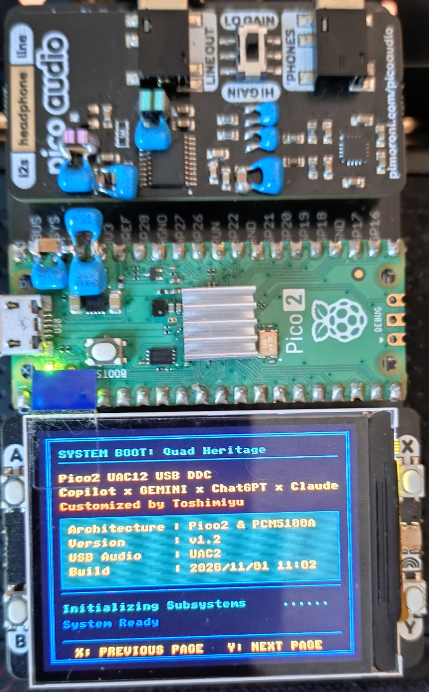
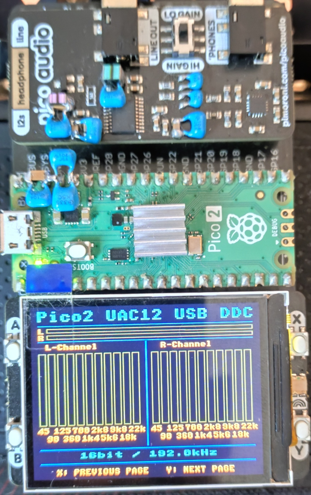
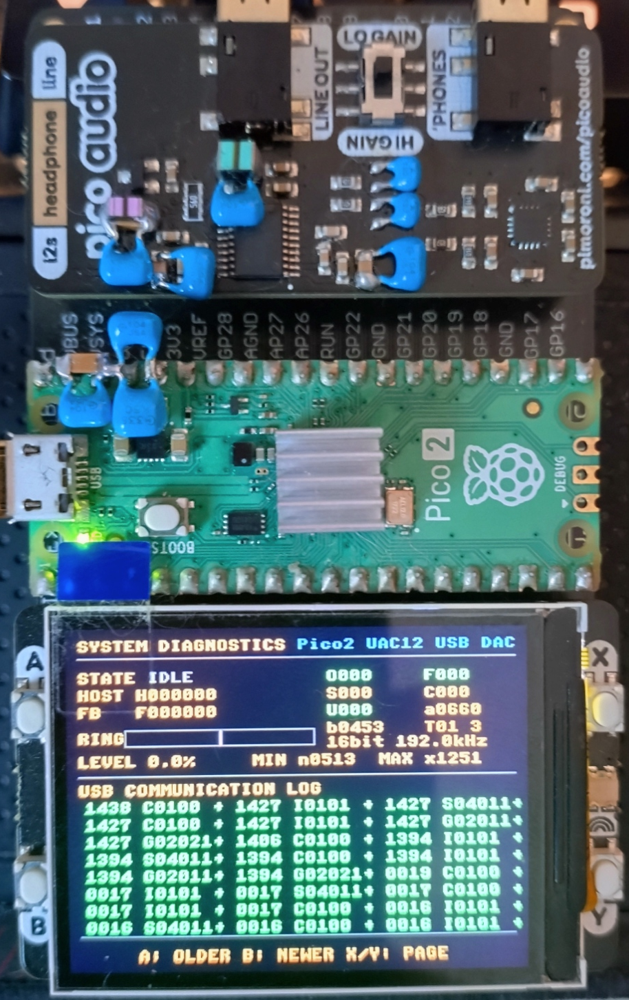

# Pico2 UAC12 USB DDC (TinyUSB UAC1/UAC2 Selectable)

## Description
- Firmware for Raspberry Pi Pico 2 (RP2350) featuring a selectable TinyUSB UAC1/UAC2 device layer, shared asynchronous feedback and audio core, an 11-band FFT spectrum display, and a real-time buffer water-level monitor. It does not use oversampling or FIR filtering.
- Operation has been verified with PCM5100 / PCM5102A on PICO_AUDIO_PACK hardware.
- **Build Verified**: Raspberry Pi Pico SDK v2.3.1 / Toolchain 15_2_Rel1

## 概要
- 本プロジェクトは、RP2350（Raspberry Pi Pico 2）上で動作するUSB-DDCです。TinyUSBのUSB Audio Class 1.0 / 2.0をビルド時に選択できます。
- UAC1/UAC2で共通のAudio State、Ring Buffer、非同期Feedback制御、PCM処理、FFT/表示、I2S/DAC制御を使用します。クラス差分は各USB Audio層に分離しています。
- USB経由で入力された2ch PCMオーディオ信号をオーバーサンプリングやFIRフィルタ処理を行わず、ビット深度32bitでI²Sインターフェイスへ出力します（NOS化）。
- LCDディスプレイ上に、**ハン窓およびA特性係数を適用したリアルタイム11バンドFFTスペクトラム表示**および**バッファー水位計**を搭載しています。
- **音声クリッピング対策を実装**
  ※DEFAULT_GAIN_RATIO = 0.80 を採用しています。
  0.70 / 0.75 / 0.80 / 0.83 / 0.85 / 1.00 の設定について、
  FFT測定および実音源による比較試聴を実施しました。
  FFT測定では、DEFAULT_GAIN_RATIO=0.80設定において

  100Hz
  THD 0.00104%
  THD+N 0.00743%

  1kHz
  THD 0.00231%
  THD+N 0.00696%

  20kHz
  THD 0.00971%
  THD+N 0.01650%

  を示し、高域特性も維持していました。
  試聴では、0.70および0.75は高域の抜けが不足し、0.83以上はよりクリアでしたが、筆者の試聴環境では刺激感が増す傾向がありました。
  透明度・高域の抜け・聴き心地・クリッピング余裕を総合評価した結果、本システムでは DEFAULT_GAIN_RATIO = 0.80 を実用最適値として採用しています。
  ※本結果はPICO_AUDIO_PACK（PCM5100A/PCM5102A）および筆者環境での評価結果であり、使用するDACや再生環境によって最適値は異なる可能性があります。

- **ビルド確認環境**: Raspberry Pi Pico SDK v2.3.1 / ツールチェーン 15_2_Rel1 にてビルド確認済み

## 特長
- **USB Audio Class 1.0 / 2.0 切替対応**
- UAC1: 16/24bit PCM、44.1/48/88.2/96kHz
- UAC2: 16/24/32bit PCM（Full-Speed帯域に応じたレート制限あり）
- **Async Feedback Endpoint による非同期フィードバック制御**
- **リアルタイム・バッファー水位計装備**（RingBufferの蓄積状況を視覚化）
- **A特性補正を適用した11バンドFFT表示**
- **音声クリッピング対策を実装**
- **SDK v2.3.1 / ツールチェーン 15_2_Rel1 対応**
- Raspberry Pi Pico 2 (RP2350) 専用
- No Oversampling (NOS)
- No FIR Filtering
- ダイレクトPCM出力
- DMA + PIOによる低遅延I²S伝送
- Dual Core RP2350対応
- PICO_AUDIO_PACK互換 / Pico Display Pack 2.0互換
- Foobar2000＋ASIO4ALLでのサンプルレート表示確認
  USB Audio Class 2.0により、ホスト側から指定されたサンプリングレートに応じて動作クロックを切り替えます。
  Foobar2000＋ASIO4ALL(Ver.2.22)で、再生レートに合わせて本機側の表示が切り替わることを確認しています。
  Windows側の出力サンプリングレート設定によっては、音切れが発生する組み合わせがあります。
  動作安定性は再生環境や設定によって異なるため、ご確認の上ご使用ください。

## Hardware Photo

### Complete System





Pico2 + Pico Audio Pack (PCM5100A) + Pico Display Pack 2.0


## 表示仕様（Pico Display Pack 2.0）
起動時は起動画面を表示し、起動処理完了後は再生画面を表示します。Pico Display Pack 2.0 の X/Y ボタンで、起動画面・再生画面・診断画面を切り替えられます（X: 前の画面、Y: 次の画面）。診断画面では A ボタンでUSB通信ログを過去方向へ、B ボタンで最新方向へスクロールします。

再生画面には、以下のリアルタイム情報およびオーディオビジュアライザーが描画されます。
- **L/R レベルメーター**: ステレオ音声の音量レベルをリアルタイム表示。
- **L・R 独立 11バンド FFT 表示**: A特性補正を適用した周波数スペクトラムを左右チャンネルそれぞれで11バンド分離表示。
- **オーディオ情報表示**: 現在のビット深度およびサンプリング周波数 (Fs) をリアルタイム表示。
- **表示に関する注意**: L/Rピークメーターは入力音量に応じて先端が頻繁に更新されるため、ちらついて見える場合があります。これはピーク表示の動作によるものです。

### 診断画面の使い方
再生画面から X ボタンを押して診断画面に切り替えます。診断画面からは X/Y ボタンで前後の画面へ移動できます。

画面上部にはUSBオーディオとバッファーの状態を表示します。
- **STATE**: `IDLE`（停止中）、`BUFF`（再生開始待ち）、`STRM`（通常再生中）、`SWCH`（サンプルレート切替中）、`OVF!`（バッファー過多）、`UDF!`（バッファー不足）。
- **HOST / FB**: ホストが指定したサンプルレートと、機器からホストへ通知しているフィードバック周波数（Hz）。
- **ビット深度 / サンプリング周波数**: 現在の音声フォーマットを `24bit 96.0kHz` の形式で表示します。
- **RING / LEVEL**: リングバッファーの現在水位と容量に対する割合。バー上の白線は目標水位です。
- **MIN / MAX**: 再生中に記録したリングバッファー水位の最小値と最大値（サンプルフレーム数）。

右側の8項目は再生・処理の診断カウンターです。`O` はリング満杯による破棄フレーム数、`F` はUSB受信FIFOの再同期で破棄したフレーム数、`S` はサンプルレート切替中に破棄したフレーム数、`C` は再起動・停止処理でクリアしたフレーム数、`U` は再生中に出力が停止した回数です。通常、`O/F/U` は0が目安です。`S/C` は切替や再起動に伴い増えることがあります。`a/b` はそれぞれCore0/Core1の最長処理間隔（µs）、`T` は最後のDMAブロックのみを出力した回数です。

画面下部にはUSB通信イベントを**3列×8行で最大24件**表示します。ログは新しいものから順に並び、機器内には直近24件を保持します。表示順は**左から右、上から下へ進むほど古く**なります（左上が最新、右下が最古）。**A ボタンで過去のログへ、B ボタンで新しいログへ**スクロールします。ログの時刻は起動後の秒数です。イベント記号は `G/S`（USB制御要求の取得/設定）、`I/C`（音声インターフェース開始/停止）、`U`（USB切断）、`W/D/K`（サンプルレート切替の開始/排出完了/クロック切替）を表します。末尾の `+` は成功、`-` は失敗です。イベントがまだない欄は空白になります。

### 再生が停止したときの記録
再生が停止したり音切れが発生したりした場合は、原因調査のため、可能であれば**診断画面をすぐに撮影**してください。USBイベントログは直近24件を保持するため、新しいイベントが増えると古いログから上書きされます。A ボタンで過去のログを確認し、撮影時には画面上部の状態表示とログ全体が分かるようにしてください。

写真に加えて、次の情報を分かる範囲で記録してください。
- `STATE`、`HOST`、`FB`、`RING`／`LEVEL`、`MIN`／`MAX`
- `O/F/S/C/U`、`a/b`、`T` の各カウンター
- USB通信ログ全体（画面に表示された最大24件）
- 使用中のサンプルレート・ビット深度、PCのOS、再生ソフト
- 発生時刻、停止直前の操作、音が完全に止まったか、自然に復帰したか、再生操作やUSB再接続で復帰したか

これらの情報を提示すると、USB通信、バッファー水位、音声出力状態を照らし合わせて原因を調べる手掛かりになります。

記録した診断画面の写真と情報は、主要なAIサービスに質問する際の資料としても利用できます。発生状況・再現手順・使用環境もあわせて伝え、「ログから考えられる原因候補」と「追加で確認すべき点」を分けて尋ねてください。AIの回答は原因を確定するものではないため、候補として扱い、必要に応じて実機で確認してください。写真やログにシリアル番号などの個人識別情報が含まれる場合は、共有前に隠してください。

再生画面には診断情報を重ねて表示しません。

## 対応OS
- Windows11
※Windows11　26H2にて動作確認済み
※UAC1モードはOnkyo HF Player (Android)との互換性を目的としています。HF Playerでの認識・再生はAndroid実機で確認してください。

## USB Audio Classの切り替え方法

UAC1/UAC2は、CMake設定`USB_AUDIO_CLASS_VERSION`でビルド時に切り替えます。設定値は`1`がUAC1、`2`がUAC2です。未指定の場合はUAC2になります。

### コマンドラインから設定する場合

リポジトリのルートフォルダーで、使用するモードに応じて次のコマンドを実行してください。

```powershell
# UAC1で構成する
cmake -S . -B build -DUSB_AUDIO_CLASS_VERSION=1

# UAC2で構成する
cmake -S . -B build -DUSB_AUDIO_CLASS_VERSION=2
```

切り替えるときも同じコマンドを再実行してCMakeを再構成し、その後にビルドしてください。VS CodeのCMake機能を使う場合は、CMake cacheの`USB_AUDIO_CLASS_VERSION`を`1`または`2`に変更して再構成した後、ビルドします。設定を変更せずにビルドした場合は、前回選択したモードのままです。

### Windows PowerShellでビルドする場合

`cmake`を実行したときに「コマンドとして認識されません」と表示される場合は、CMakeがインストールされていないか、CMakeの実行ファイルがPATHに登録されていません。まず、次のコマンドでPATHからCMakeが見つかるか確認します。

```powershell
where.exe cmake
```

何も表示されない場合、CMakeが未インストールなら次のコマンドでインストールし、PowerShellを閉じて開き直してください。

```powershell
winget install Kitware.CMake
```

CMakeがすでにインストールされているのに見つからない場合は、`cmake.exe`があるフォルダー（通常は`C:\Program Files\CMake\bin`）をPATHに追加します。すぐに現在のPowerShellだけで使うには、実際のインストール先に合わせて次を実行します。

```powershell
$env:Path += ";C:\Program Files\CMake\bin"
```

今後開くPowerShellでも使えるようにするには、Windowsの「環境変数を編集」を開き、「ユーザー環境変数」の`Path`に`cmake.exe`があるフォルダーを追加して保存し、PowerShellを開き直してください。インストール先が上記と異なる場合は、そのフォルダーに置き換えてください。

PATHの設定後、次のコマンドでCMakeが使えることを確認します。

```powershell
cmake --version
```

バージョンが表示されたら、PowerShellでリポジトリのルートフォルダーへ移動し、UAC1を構成してビルドします。

```powershell
cd C:\path\to\Pico2_UAC12_USBDDC
cmake -S . -B build -DUSB_AUDIO_CLASS_VERSION=1
cmake --build build
```

UAC2でビルドする場合は、構成コマンドの`1`を`2`に変更してください。構成時にSDK、コンパイラー、Ninjaなどが見つからないというエラーが出る場合は、Visual Studio CodeにRaspberry Pi Pico拡張機能をインストールし、推奨環境（Pico SDK v2.3.1 / ツールチェーン 15_2_Rel1）をセットアップしてください。

ビルドが成功すると、選択したUSB Audio Classに応じて次のUF2ファイルが `build\src` に生成されます。
- UAC1: `Pico2_UAC12_USBDDC_11FFT_NoOverSampling_UAC1.uf2`
- UAC2: `Pico2_UAC12_USBDDC_11FFT_NoOverSampling_UAC2.uf2`

Pico 2のBOOTSELボタンを押しながらPCに接続し、表示されたドライブに該当するUF2ファイルをコピーして書き込んでください。

### モードごとの仕様
- **UAC1（`USB_AUDIO_CLASS_VERSION=1`）**: USB Audio Class 1.0。16bit/24bit PCM、44.1/48/88.2/96kHzに対応します。
- **UAC2（`USB_AUDIO_CLASS_VERSION=2`）**: USB Audio Class 2.0。16bit/24bit/32bit PCMに対応します。サンプルレートの上限はビット深度とRP2350のFull-Speed帯域によって異なります（詳細は「USB入力仕様」を参照）。

クラスごとにUSB descriptorや制御部分を切り替えます。音声処理、Ring Buffer、Feedback制御、FFT/表示、I2S/DACなどは共通コードを使用します。

## 対応DAC
- TI PCM5100 / PCM5102A
※ PICO_AUDIO_PACK環境で動作確認済み

## USB入力仕様
- USB Audio Class 1.0または2.0（ビルド時選択、Async Feedback）
- PCM、2chステレオ
- UAC1: 16bit / 24bit、44.1kHz / 48kHz / 88.2kHz / 96kHz
- UAC2のビット深度・サンプルレート対応表（RP2350 Full-Speed帯域制約に基づく）：
  - **16bit**: 44.1kHz / 48kHz / 88.2kHz / 96kHz / 176.4kHz / 192kHz
  - **24bit**: 44.1kHz / 48kHz / 88.2kHz / 96kHz 
  - **32bit**: 44.1kHz / 48kHz / 88.2kHz / 96kHz 
※ Pico 2/RP2350のUSBデバイスコントローラはFull-Speedのみです。UAC2 High-Speed動作には別のUSB High-Speed対応ハードウェアが必要です。
※ 現行Full-Speed構成ではUAC2 16bitは192kHzまで、24/32bitは96kHzまでです。24/32bit 176.4/192kHzはFull-Speedの最大パケットサイズを超えるため対象外です。
※ UAC1のHF Player互換性は実機での認識・再生確認が必要です。

## I²S出力仕様
- I²S 32bit PCM Format
- Stereo
- Input Sample Rate Follow Mode
- No Sample Rate Conversion
- No Oversampling
- Direct PCM Output
※ Windowsの音量調整がデジタル処理を行う場合があります。音量調整方法は再生環境に応じて設定してください。

## Playback Notes
- Windows側の出力レート設定によって音切れが出る組み合わせがあります。また再生時は、ご使用のPC環境や負荷状況により音切れが発生する場合があります。
- 音切れが発生する場合は、再生経路（ASIO、WASAPI等）を切り替えたり、再生ソフトウェアまたはOSのサンプリングレート設定を下げてご使用ください。
- Audio dropouts may occur with certain Windows output sample-rate settings. Dropouts may also depend on the host PC, system load, and playback configuration.
- If dropouts occur, try changing the playback path (e.g., ASIO or WASAPI) or lowering the sample rate in the audio player or operating system.

## FFT Spectrum Display & Buffer Monitor
### Real-time 11-band FFT spectrum analyzer (with Hann Window & A-Weighting) and Buffer Water Level Meter.
表示・解析デバイス: Pico Display Pack 2.0 (ドーターボード経由接続)
表示バンドの周波数:
- 45Hz
- 90Hz
- 125Hz
- 360Hz
- 700Hz
- 1.4kHz (1k4)
- 2.8kHz (2k8)
- 5.6kHz (5k6)
- 9.8kHz (9k8)
- 18kHz
- 22kHz

### Configuration:
- FFT_LEN = 2048
- Window Function: **Hann Window**
- Weighting: **A-Weighting (A特性係数適用)**
- RingBuffer Water Level Monitoring with Feedback Control
The LCD display provides a real-time 11-band spectrum visualization and buffer status optimized for RP2350 performance and low display latency.

## 使用技術・構成
- ハードウェア: RP2350 (Raspberry Pi Pico 2)
- 開発環境: **VSC環境　Raspberry Pi Pico SDK v2.3.1 / ツールチェーン 15_2_Rel1** (ビルド確認済み)
- 表示・解析デバイス: Pico Display Pack 2.0 (ドーターボード経由接続)
- データ転送:
  TinyUSB UAC1/UAC2クラス層と共通Audioコア、DMA + PIOによる低遅延I²S出力
- マルチコア処理:
  Core0
  - LCD描画処理（FFT・バッファー水位計含む）
  - クロック切り替え制御（ハイパワー固定、44.1kHz系: 336MHz / 48kHz系: 360MHz）
  - DACミュート制御
  - タイマー管理処理

  Core1
  - I²S出力処理
  - DMA転送処理
  - FFT解析処理（ハン窓・A特性演算含む）
- USB制御:
  **TinyUSB UAC1/UAC2選択層** および共通 **Async Feedback クロック同期制御**
- タイミング制御:
  Repeating Timer による周期管理
- RAM実行とフラッシュクロック分周の設定
  プログラムをRAM上で実行。
  フラッシュクロックの分周値は3に設定。
  動作確認では、44.1/88.2kHz系で112MHz、48/96kHz系で120MHzと表示されました。

## ピンアサイン詳細
- I2S DATA : `GP9`
- I2S BCLK : `GP10`
- I2S LRCK : `GP11`
- I2C SDA  : `GP6`
- I2C SCL  : `GP7`
- DAC ENABLE : `GP5`
- Pico Display (SPI/Ctrl) : `GP16` - `GP20`
- Pico Display カラーLED : ピンアサインの衝突を防ぐため**停止状態（非使用）**に設定
- Pico Display ボタン X/Y : 画面切り替えに使用（GP14/GP15、内部プルアップ）
- Pico Display ボタン A/B : 診断画面のUSB通信ログ操作に使用（GP12/GP13、内部プルアップ）

## ビルド・使用方法
1. 機器の接続は**ドーターボード経由**で行ってください。
2. Visual Studio Code 上で Raspberry Pi Pico 拡張機能をインストールする。
  （※ **SDK 2.3.1 / ツールチェーン 15_2_Rel1** 環境でのビルドを推奨・確認済み）
3. 本リポジトリをクローンする。
4. VSCode上でビルドを実行する（`build/src` にバイナリが生成されます）。
5. Pico 2 の **BOOTSEL ボタン** を押しながらPCに接続し、ドライブ（`RP2350`）として認識させる。
6. 生成されたファームウェア（`.uf2`）をドラッグ＆ドロップして書き込む。
7. 接続後、選択したUSB Audio Class（UAC1またはUAC2）のデバイスとして認識されます。

### 改修に至った理由
- ノンオーバーサンプリング化とソフトウェアFIRフィルターの削除により、サンプルレート切り替え時のノイズ削減と周波数特性の改善を行っております。
- DAC側でオーバーサンプリング処理＆FIRフィルターが実装されており、必要ないとの判断に至ったため。
- 音声処理を簡素化し、USB入力信号をなるべく加工せずに出力する設計としました。
- MCUを処理能力向上のため、オーバークロック状態に設定しています。オーバークロック動作への対策として、発熱を抑える目的でヒートシンクを取り付けています。※動作確認はこの状態にて確認しております。
- さらに、USBオーディオの転送品質とクロック追従性を高めるため、LUFAからTinyUSBへ移行し、UAC1/UAC2の切替層と共通Async Feedback制御を導入しています。視覚的な安定性を確認できる**バッファー水位計**に加え、**ハン窓・A特性適用FFT表示**および音声クリッピング対策を維持しています。
- 開発環境についても **SDK v2.3.1 / ツールチェーン 15_2_Rel1** にて動作を確認。

### 改修履歴（Pico2_UAC2_USBDDC_VerFinal_11FFT_NoOverSampling からの主な変更点）
- **UAC1/UAC2の選択に対応**: CMake設定 `USB_AUDIO_CLASS_VERSION` により、ビルド時にUSB Audio Class 1.0または2.0を選べるようにしました。
- **USBオーディオ処理を整理**: TinyUSBを使用し、UAC1/UAC2固有の記述子・要求処理をクラス別に分離しました。PCM処理、リングバッファー、非同期フィードバック制御などは共通化しています。
- **ストリーム制御と診断情報を拡充**: サンプルレート変更時の切替手順を整理し、リングバッファー水位、ドロップ数、処理間隔、USB制御イベントなどを確認できるようにしました。
- **診断画面を追加・改善**: Pico Display Pack 2.0で再生画面と診断画面を切替可能にしました。診断画面ではビット深度・サンプリング周波数、状態・水位・各種カウンターを表示し、USB通信イベントを3列×8行で最大24件確認できます。A/Bボタンでログをスクロールできます。
- **クロック動作をハイパワーに固定**: 不要な低電圧・低クロックモードとGPIOによるモード切替処理を削除し、サンプルレートに応じたクロック切替は維持しました。
- **不要なGPIOデバッグ機能を削除**: 使用していない `debug_with_gpio` モジュールと関連処理を取り除きました。
- **RAM実行を維持**: 起動時にプログラムをRAMへコピーして実行する設定を使用しています。

## FFT測定による検証
- Ver7 変更内容

オーバーサンプリング関連コード削除

FIR関連コード削除

ES系DAC出力関連コード削除

I2C出力関連コード削除

信号経路および処理経路の整理

### Ver6との比較において、同一測定環境下で以下の変化を確認した。

### 測定結果
100Hz    Ver6       Ver7
THD    : 0.00104% → 0.00030%
THD+N  : 0.00743% → 0.00563%

1kHz
THD    : 0.00231% → 0.00141%
THD+N  : 0.00696% → 0.00508%

10kHz
THD    : 0.00996% → 0.00988%
THD+N  : 0.01889% → 0.01854%

20kHz
THD    : 0.00971% → 0.01585%
THD+N  : 0.01650% → 0.02701%

IMD (19kHz + 20kHz)
THD    : 0.01086% → 0.01040%
THD+N  : 0.04472% → 0.04454%

IMD差周波成分（1kHz）
-118.71dB → -121.09dB

※ハードウェア構成、測定環境、測定条件は同一であり、ファームウェアのみ変更。

### 試聴結果

Ver6と比較して、

濁り感の減少
素直で見通しの良い音調

を確認した。

### 考察

今回の変更では、信号経路および処理経路を簡素化した。

測定結果および試聴結果には変化が確認されたが、

- 信号経路短縮の効果
- 分岐条件削減の効果
- LUFA版とUAC2版の差異

を個別に切り分けた検証は実施していない。

そのため、

「信号経路短縮によって測定結果が改善した」

あるいは

「測定結果の改善が試聴結果の改善要因である」

とは断定できない。

一方、本比較ではハードウェア構成・測定環境・測定条件は同一であり、変更した要素はファームウェアのみである。

そのため、今回観測された測定結果および試聴結果の差は、ファームウェア変更によって生じたものであることが確認された。

ただし、ファームウェア内部のどの変更要素が結果に寄与したかについては、現時点では特定できていない。

なお、20kHzのTHDおよびTHD+NはVer6比で悪化傾向を示したが、本システムにおいては試聴上の問題は確認されなかった。

## ライセンス
- MIT License
- Additional modifications and implementation by Toshimiyu.

## 参考文献
- USB Audio Class 2.0 Specification
- TinyUSB Stack
- Raspberry Pi Pico SDK (v2.3.1)