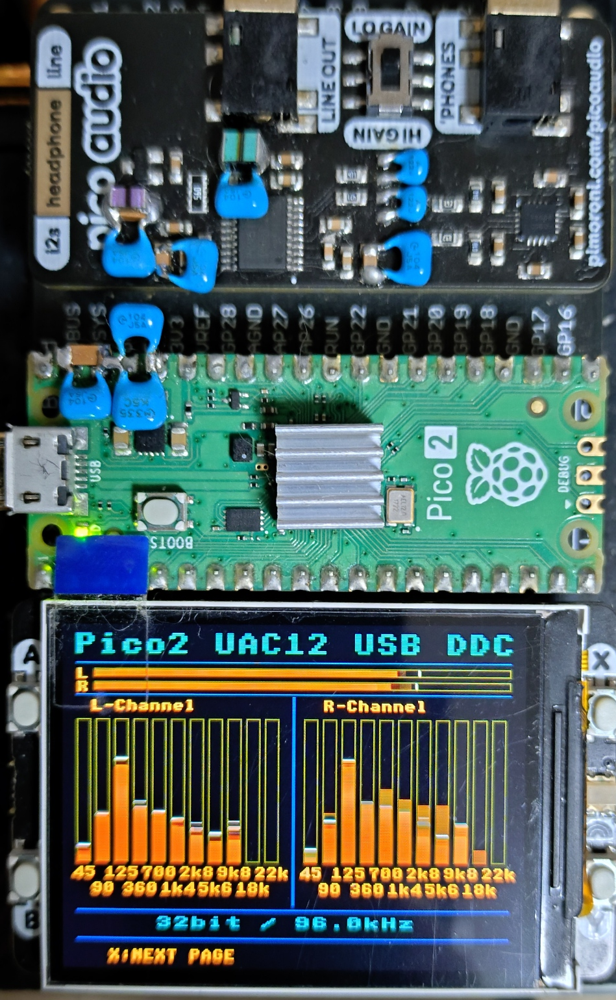
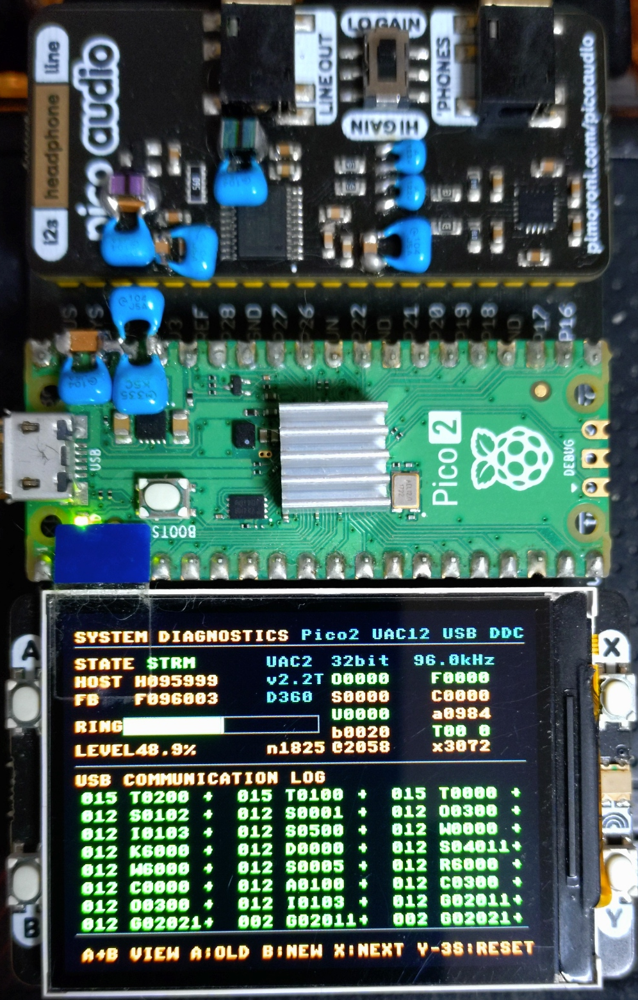

# Pico2 UAC12 USB DDC（TinyUSB UAC1/UAC2 切替対応）

[English](README_EN.md) | [日本語](README.md)

**現行バージョン: v2.7**

## 概要

本プロジェクトは、従来の `Pico2_UAC2_USBDDC_VerFinal_11FFT_NoOverSampling` を大幅に更新した、RP2350（Raspberry Pi Pico 2）用のUSB-DDCファームウェアです。

TinyUSBをベースにUSBオーディオ機能を再構成し、ビルド時にUSB Audio Class 1.0（UAC1）と2.0（UAC2）を選択できます。USBクラス層を分離しながら、共通のオーディオ処理コアを使用します。

### 主な変更点

- UAC1 / UAC2をビルド時に選択可能
- TinyUSBベースのUSBオーディオ層
- Audio State、Ring Buffer、Feedback制御の共通化
- バッファー監視機能を備えた診断画面
- 最大64件（CDC有効時は256件）のUSBイベントログ
- UAC1/UAC2と同時に使用できるUSB CDC診断ログ（CSV）
- ストリーム再開およびサンプルレート切替処理の改善
- 未使用のGPIOデバッグ機能を削除
- 高クロック動作を修正
- UAC1 / UAC2で共通のオーディオ処理コアを使用

オーディオ処理の仕様は以下のとおりです。

- オーバーサンプリングなし（NOS）
- FIRフィルター処理なし
- サンプルレート変換なし

USB受信データはリングバッファーへ格納する前に、PCMサンプル幅（16/24/32-bit）とステレオフレーム境界を検証します。不正な形式や境界を検出した場合はTinyUSBのOUT FIFOを破棄して再同期し、CDC診断ログと統計カウンターに記録します。破棄後も通常の状態機械を維持し、内部状態名`UNDERFLOW_FATAL`（診断画面のSTATE表示では`UDF!`）中は有効データの蓄積を待って既存の再バッファリング経路で復帰します。

また、PCM入力の隣接サンプルから急峻な変化の候補を計測します。しきい値超過時は`PCM_CLICK_CANDIDATE`として記録しますが、音声データや再生ゲインは変更しません。正常な高周波信号でも記録される可能性があるため、これはクリック確定ではなく調査用の診断です。ホストがゼロPCMを送り続ける場合は、2ms以上の無音後に約5msでフェードインします。

起動時はI²Sクロックとゼロデータを7秒間出力し、その間に受信したUSB音声は破棄します。以後、USB音声データを1秒間受信せず、残った音声のフェードとDACのゼロ検出時間が終わるとI²Sを停止します。無音PCMが届き続ける間はクロックを維持します。受信再開時はI²Sのゼロ出力とDACのゼロ検出時間を経て、通常のプリフィル後に再生します。DACアナログ出力が0 Vになることを保証するものではありません。

PCM不足時は最後のサンプルからサンプルレートに応じた約5msでゼロへフェードし、DMAが無音状態から再開する場合も約5msでフェードインします。ストリームがプリフィル中に閉じた場合は未再生データを破棄し、再開時は以前のDMA出力が終わるまで待ちます。

再生中にホストからストリーム終了要求を受けた場合は、転送中のDMAブロックが終わってから残りのPCMを約20msでフェードアウトし、その後はゼロ出力にします。PCMが不足する場合はフェードの途中でも従来の無音補完処理に移ります。CMakeの`USB_AUDIO_ENABLE_STOP_FADE`は既定でONです。比較のためOFFにしたビルドは版名に`N`が付きます。この機能によるプツ音の解消は保証されません。

11バンドFFTアナライザー、リアルタイムレベルメーター、バッファー水位計などの表示機能を維持・改善しています。

## 対応環境

- **Windows 11** （26H2で確認、UAC2。WASAPIではWindowsと音源のサンプルレートを合わせてください。v2.7以降、UAC2モード動作時にノイズは確認できていません。）
- Android（UAC1。Android標準ドライバー経由でのOnkyo HF Player再生と、HF Player USBドライバーでの動作を実機確認）
- ビルド環境：Raspberry Pi Pico SDK v2.3.1、Toolchain 15_2_Rel1

ビルドにはリポジトリ同梱のTinyUSB（表示バージョン0.21.0）を使用します。Pico SDK 2.3.1同梱版ではUSBイベントAPIが異なり、ビルドできません。UAC2のFull-Speedフィードバックは現状4バイトで送信され、ホスト互換性は別途実機確認が必要です。

UAC2の`CLK_VALID`はレート切替中も1を返し、サンプルレートのGET_CURは切替要求中の値を返します。この組み合わせのホスト互換性は未検証です。

現在のUSB識別子 `0x2e8a:0xfede` のPID割り当ては未確認です。配布前に[Raspberry PiのPID割り当て](https://github.com/raspberrypi/usb-pid)を確認し、必要な割り当てを取得してください。

AndroidではUAC1モードを使用してください。標準ドライバー経由での再生時に発生するノイズは調査中です。UAC2モードはWindows向けです。詳しくは「対応OS」を参照してください。

## 設計目標

- オーディオ信号経路を簡素化する
- 不要なソフトウェアDSP処理をなくす
- オーバーサンプリング、FIRフィルター、サンプルレート変換を行わない信号経路にする
- USB Audio Classごとのコードを分離し、保守性を高める
- UAC1 / UAC2で共通のオーディオエンジンを使う
- トラブルシューティング用のリアルタイム診断機能を提供する

PCM5100Aは内部でオーバーサンプリングとデジタルフィルター処理を行うため、本ファームウェアではソフトウェアのオーバーサンプリングとFIRフィルターを使用しません。

オーバーサンプリング、FIRフィルター、サンプルレート変換は行いませんが、出力には固定ゲイン比0.80を適用し、さらにUAC1/UAC2の音量設定（0～-64dB）およびミュートをソフトウェアで反映するため、PCMサンプルの値は変化します。

USBミュート／解除は入力PCMに約5msのリニアなゲインランプを適用します。音量変更は従来どおり即時反映します。これらの操作はリングやDMAに既に格納された音声を変更しないため、実際の出力への反映はバッファー分遅れます。ストリーム終了時とPCM不足時はDMA出力にもフェードを適用しますが、入力形式の異常時に自動ミュートする機能はありません。

## 変更履歴

<details>
<summary>バージョン履歴を表示</summary>

### V2.7

- **CDC診断ログの変化検出ロジックを実装**
  - 周期ログ（100ms）: ホストレート、フィードバックレート、リングレベル、アンダーフロー、USB状態の変化のみ記録し、無変化時の出力を削減
  - FAST ログ（1ms）: リングレベル変化 > 200フレーム時のみ記録。500ms ごとに強制出力して可視性を確保
  - 結果：ログサイズを約 **98.8～99.0% 削減**（実機テスト時: 48.5 MB → 0.59 MB）
- CDC診断ログのCSV形式を改善し、`RATE_CHANGE_COUNT`（CDCセッション中の累積レート切替数）と`UNDERFLOW_COUNT`（起動後の累積数）の累積期間を明確化
- ドキュメント [CDC_CHANGE_DETECTION.md](docs/CDC_CHANGE_DETECTION.md)、[LOG_ANALYSIS_REPORT_v2_CORRECTED.md](LOG_ANALYSIS_REPORT_v2_CORRECTED.md) を追加し、実装詳細と実機テスト結果を記載
- 診断ビルド（`USB_BRINGUP_LEVEL=3` 以上）での長時間ログ取得が実用的になり、音声再生を停止しながら診断を継続可能に

### V2.6

- ビルド・自動化インフラを改善。CMakeCache.txt から USB_BRINGUP_LEVEL を自動読み取る PowerShell スクリプト群を追加
- 複数のビルドレベル（Level 2: 通常版、Level 3: CDC診断版、Level 4: 高負荷診断版）を一括検証するスクリプトを実装
- VS Code 用ビルド設定スクリプト `configure-vsc-build.ps1` を追加。cmake コマンドを簡潔に（`-DUSB_AUDIO_CLASS_VERSION=2` のみ）
- イベントログバッファサイズ（EVT_LOG_N）を条件付きで最適化（CDC有効時 256→128）し、RAM使用量を512B削減
- ビルドログ管理を `build-logs/` ディレクトリで一元化し、コミット対象に設定
- ドキュメント `BUILD_CONFIGURATION_FACTS.md`、`SLIMMING_SUMMARY.md`、`DOCUMENT_STATUS.md` を追加し、ビルド構成と最適化方針を明記
- ビルド・キャプチャスクリプトの重複排除と共通ライブラリ化により、メンテナンス性を向上

### V2.5

- PCM不足時のフェードアウトを固定64フレームからサンプルレートに応じた約5msに変更
- ホストがゼロPCMを送り続ける場合、2ms以上の無音後に約5msでフェードイン。DMA側のフェードインとの重複を抑制
- PCMクリック候補は診断として記録し、候補だけを根拠に音声を加工しない
- 起動時のI²Sゼロ出力を10秒から7秒に変更
- USBサスペンド後はAudio StreamingのAlt設定を保持し、レジューム時にプリフィルから再開。レート切替の排出待ち期限はクロック準備後に計測
- BUFFERING／クロック準備待ちの長時間化、オーバーフロー、再バッファリングの診断表示とCDCログのタイミング情報を追加。待機タイムアウトは診断のみ
- 通常版の版名を`v2.5`、CDC診断版を`v2.5T`に更新。USBの`bcdDevice`は変更なし
- 今回のフェード対策によるプツ音の改善は実機での聴感確認が必要

### V2.4

- 起動時のI²Sゼロ出力を10秒間行い、その間のUSB音声を破棄
- USB音声データが1秒間途絶え、残音のフェードとDACゼロ検出時間が終わるとI²Sを停止。無音PCMの受信中はクロックを維持し、再受信時はゼロ出力と通常のプリフィルを経て再生
- PCM不足時の64フレームフェードアウトと約5msのフェードイン、プリフィル中に閉じたストリームの未再生データ破棄を追加
- ホストのストリーム終了要求後、残りのPCMに約20msのフェードアウトを適用
- USB受信FIFOを最大24パケット相当に拡張し、高水位時の保持量を調整
- 最適化を`-O3`に変更し、I²SのPIO分周を丸めた16:8値で設定
- 通常版の版名を`v2.4`、CDC診断版を`v2.4T`に更新。USBの`bcdDevice`はUAC1 `0x0303`、UAC2 `0x0313`のままです。I²S停止・再開時のDACアナログ出力波形は実機で未測定です。

### V2.3

- 44.1/88.2kHz再生時は330MHz（`D330`）、176.4kHz再生時は307.2MHz（`D307`）の専用システムクロックへ切り替え、PIO分周量子化による平均サンプルレート誤差を低減（44.1kHzは約6.25ppmから約0.91ppm、88.2kHzは約6.25ppmから約0.91ppm、176.4kHzは約125ppmから約1.95ppm）。USB入力ビット深度によらず、同じI²S出力クロックを使用します。実機でのジッター低減効果は未測定です。
- ホスト送信レートの計測を診断表示・CDC接続から分離し、診断の有効／無効によってフィードバック制御の計測が変わらないようにしました。
- DMA AHBエラー検出時に通常完了として扱わず復旧処理を行い、レート切替時はクロック変更前にPIOを停止するようにしました。エラー復旧と切替時の実機検証は引き続き必要です。
- リングバッファーの確保失敗時に起動を停止し、共有状態の読み取りとクリアを同期。UAC1フィードバックの`bRefresh`と反転I²S PIOの設定も修正しました。
- フィードバック監視画面を追加。診断ビルドでは、オプションで音声OUT転送の先頭1024件をRAMに記録し、Android接続中に画面で確認できます。詳細は[Android検証手順](docs/ANDROID_TEST.md)を参照してください。
- 通常版の版名を`v2.3`、CDC診断版を`v2.3T`に更新。USBの`bcdDevice`はUAC1 `0x0303`、UAC2 `0x0313`のままです。

### V2.2

- フィードバック目標をリング容量の50%（2048フレーム）に変更し、水位初期化、条件付き積分、レート比例ゲイン、ストリーム間のクロック差推定値の引き継ぎを既定で有効化。USB再列挙後のシード無効化は未確認です。
- UAC1/UAC2のOutput Terminalを`0x0602`（Digital Audio Interface）から`0x0301`（Speaker）へ変更。UAC1ではAndroid標準ドライバーでの認識とOnkyo HF Playerでの再生、およびHF Player USBドライバーでの動作を実機確認。標準ドライバーでの再生時のノイズは調査中です。
- CDC診断ログにOFFSET_SEED/UPDATE、USBイベントカウンター、PCMトレースなどを追加。CDC診断ビルドではFFT計算・表示を停止し、診断画面とログ取得を優先します。

### V2.1

- **仕様変更：** UAC1/UAC2のOutput Terminalを`0x0304`（Desktop Speaker）から`0x0602`（Digital Audio Interface）に変更。AndroidはUAC1版とOnkyo HF Playerを使い、HF PlayerのUSBドライバーを使用する前提とし、UAC2版はWindows向けとします。
- UAC1/UAC2の`bcdDevice`をそれぞれ`0x0303`/`0x0313`に更新
- 診断画面のO/F/S/C/Uを4桁表示に変更し、リング水位の現在値・最小値・最大値を記号付きで表示
- CDC診断ログにフィードバック制御値とUSB OUT最終受信からの経過時間、UNDERFLOW発生時の詳細行を追加
- USBイベント履歴をCDC接続時から出力し、診断画面で確認可能に変更
- CDC有効時のUSBイベント履歴を64件から256件に拡張し、CDC接続直後の周期行の経過時刻を修正
- 診断画面のUAC表示下にファームウェア版とシステムクロック（`D330` / `D307` / `D360`）を表示。水位の現在値・最小値・最大値は`@` / `n` / `x`で示し、MIN/MAX見出しとUSB/CDC接続状態表示を削除

### V2.0

- オーディオリングを2048から4096ステレオフレームに拡張し、目標水位と通常再生時の最低プリフィルを3072フレーム（75%）に変更
- フィードバック補正の基本上限を100ppm、低水位時の最大上限を1000ppmとし、バッファリング中の要求に公称レートの500ppm分を加算
- サンプルレート切替時の排出待ちタイムアウトを150msに変更
- システムクロックが同じ場合は電圧とPLLの再設定を省略し、I²S分周比は更新
- UAC1/UAC2のUSB構成記述子の最大消費電流を150mAに設定（USBテスターによる実測値は約140mA）
- DMA転送を完了IRQ駆動に変更し、再生中のPCM不足時は64フレームの無音データを補完
- フィードバック周波数の基準を公称サンプルレートからPIO分周値に基づく実出力レートへ変更
- USB受信FIFOが75%を超えた場合、全体を破棄せず古いフレームを削除して水位を約50%まで下げる
- UAC1の音量`SET_RES`要求に対応
- CDC有効ビルドで状態遷移とDMA無音補完の履歴を記録し、CDCログと再生開始ログ画面で確認可能に変更


V1.0〜V1.9の変更履歴は[CHANGELOG.md](CHANGELOG.md)を参照してください。

</details>

## 特長

- USB Audio Class 1.0 / 2.0 切替対応
- Async Feedback Endpointによる非同期フィードバック制御
- 約6ms分と3072フレームの大きい方をプリフィルした後にI²S再生とPIフィードバック制御を開始
- リアルタイムバッファー水位計
- A特性補正付き11バンドFFT表示
- オーバーサンプリングなし（NOS）
- FIRフィルターなし
- オーバーサンプリング、FIRフィルター、サンプルレート変換を行わないI²S出力
- DMA + PIOによる低遅延I²S転送
- RP2350デュアルコア対応
- PICO_AUDIO_PACK対応
- Pico Display Pack 2.0対応

## 測定結果

<details>
<summary>測定結果を表示</summary>

Ver8の実測データ（測定記録・波形など）は、[DAC Modification History（2026年11月1日公開分）](https://github.com/Toshimiyu/DAC_Modification_History/tree/main/PicoAudioPack/20261101)で公開しています。

### ファームウェア比較

Ver7(開発呼称) → Ver8(開発呼称)

ハードウェア構成、測定環境、測定条件は同一で、ファームウェアのみを変更しています。

Ver7は `Pico2_UAC2_USBDDC_VerFinal_11FFT_NoOverSampling`、Ver8は `Pico2_UAC12_USBDDC` です。

### Ver7(開発呼称)

- TinyUSB UAC2ベース
- UAC2専用構成
- Audio State、Ring Buffer、Feedback制御をUAC2専用構成として実装
- オーバーサンプリング関連コードを削除
- FIR関連コードを削除
- ES系DAC対応コードを削除
- I2C出力コードを削除

### Ver8(開発呼称)

- UAC1 / UAC2をビルド時に選択可能
- TinyUSBベースのUSBオーディオ層
- Audio State、Ring Buffer、Feedback制御を共通化
- バッファー監視機能付き診断画面を追加
- USBイベントログ（最大64件）を追加
- ストリーム再開処理を改善
- サンプルレート切替処理を改善
- 未使用GPIOデバッグ機能を削除
- 高クロック動作を修正
- UAC1 / UAC2共通オーディオコアを採用

### FFT測定

#### 100Hz

| 項目 | Ver7 | Ver8 |
|------|------:|------:|
| THD | 0.00030% | 0.00033% |
| THD+N | 0.00563% | 0.00564% |

#### 1kHz

| 項目 | Ver7 | Ver8 |
|------|------:|------:|
| THD | 0.00141% | 0.00104% |
| THD+N | 0.00508% | 0.00484% |

#### 10kHz

| 項目 | Ver7 | Ver8 |
|------|------:|------:|
| THD | 0.00988% | 0.00991% |
| THD+N | 0.01854% | 0.01868% |

#### 20kHz

| 項目 | Ver7 | Ver8 |
|------|------:|------:|
| THD | 0.01585% | 0.01611% |
| THD+N | 0.02701% | 0.02712% |

#### IMD（19kHz + 20kHz）

| 項目 | Ver7 | Ver8 |
|------|------:|------:|
| THD | 0.01040% | 0.01046% |
| THD+N | 0.04454% | 0.04489% |

IMD差周波数成分（1kHz）：

- Ver7(開発呼称)：-121.09dB
- Ver8(開発呼称)：-121.96dB

### 測定結果まとめ

- 100Hz、10kHz、20kHzのTHDおよびTHD+NはVer7とVer8でほぼ同等でした。
- 1kHzではTHDが0.00141%から0.00104%へ低下し、THD+Nもわずかに改善しました。
- IMD測定ではTHDおよびTHD+Nはほぼ同等でしたが、差周波数成分（1kHz）は約0.9dB改善しました。
- 無音時スペクトルはVer7と同等レベルで、1kHz付近の不要成分はVer7が-114.70dB、Ver8が-114.89dBでした。

### 聴感テスト

Ver7(開発呼称)との比較：

- 明確な音質差は確認されていません。
- 診断機能やイベントログ機能追加後も、違和感のある変化は確認されていません。
- 今後も継続評価を行います。

### 注記

- 測定記録はVer7、Ver8それぞれ300回平均です。
- 今回の測定は24bit/96kHz、SB-1240改によるループバック条件で実施しており、結果は再生環境や測定系によって異なります。
- Ver8では複数の変更を同時に実施しているため、特定の変更と測定結果の因果関係や各変更の寄与度は個別に評価していません。
- FFT測定ではVer7と同等レベルの結果が得られました。

※測定記録はVer7、Ver8それぞれ1系列で、独立した再測定のばらつきは記録されていません。

### YouTube再生中のフォーマット切替確認（2026年11月1日）

Windows 11 26H2とGoogle Chrome 156.0.8078.80（公式ビルド、64ビット）でYouTubeを再生しながら、UAC1版とUAC2版の各対応フォーマットへ切り替えて確認しました。UAC1版では16/24bit、UAC2版では16/24/32bitについて、44.1/48/88.2/96kHzの組み合わせを確認しています。バッファー水位が安定した状態と、安定していない状態の両方で確認し、各確認はおおむね30秒前後でした（個別の再生時間は記録していません）。

※確認中、O（リングバッファーのオーバーフロー破棄）、F（USB受信FIFO高水位時の古いフレーム破棄）、U（再生出力停止）は、いずれも0でした。これらのカウンターはデバイスが受信したデータの処理状況を示すもので、ホストやUSBバス上で発生した欠落を検出するものではありません。この結果は記載した環境での実機観測であり、他の環境や再生条件での動作を保証するものではありません。

</details>

## ハードウェア写真

### システム全体

> **組み立て時の重要注意（向き・配置）**
>
> Treedixドーターボードに各モジュールを取り付ける際は、接続の向きと、DACボード（Pico Audio Pack）およびPico Display Pack 2.0の並び順を必ず下のシステム全体写真で確認してください。向きや並び順を逆にすると、オーディオジャックなどの部品が物理的に干渉し、正しく取り付けられない場合があります。配線・半田付けを始める前に、写真と照らし合わせて配置を確認してください。

#### 起動画面


#### 再生画面



#### 診断画面



Pico 2 + Pico Audio Pack（PCM5100A）+ Pico Display Pack 2.0

## 表示・診断画面

通常ビルドではXボタンで起動画面、再生画面、診断画面、フィードバック監視画面を切り替えます。CDC診断ビルド（`USB_BRINGUP_LEVEL=3`）ではFFT表示とFFT処理を停止し、Xボタンで診断画面、フィードバック監視画面、再生開始ログ画面を切り替えます。Level 4（CDC診断＋FFT）では診断画面、フィードバック監視画面、再生開始ログ画面、再生画面（FFT表示）をXボタンで切り替えられます。診断画面のVersion欄はLevel 3が`v2.7T`、Level 4が`v2.7A`となり、撮影した写真からビルドレベルを判別できます。起動画面からは診断画面へ移行します。診断画面のA/BでUSBイベント履歴を移動し、A+Bで音声状態履歴を切り替えます。Yを3秒長押しすると診断値とUSBイベント履歴をリセットします。画面表示やイベント記号・異常コードの詳細は[診断イベント一覧](docs/DIAGNOSTICS.md)を参照してください。

## 対応OS

- Windows 11（26H2で動作確認済み。Foobar2000でWASAPIモードで再生するときは、音源のサンプリングレートとWindows11のサンプリングレートを合わせてから再生を行ってください。ASIO4ALLやASIOドライバー等の場合は、サンプリングレートが異なっていても正常に再生されます。ASIO4ALL2.22で確認済み。）
- Android（UAC1。Android標準ドライバー経由でのOnkyo HF Player再生と、HF Player USBドライバーでの動作を実機確認）

### 現行ファームウェアの仕様上の注意点

- 現行ファームウェアはUAC1/UAC2ともOutput Terminal `0x0301`（Generic Speaker / Speaker Output）を使用します。UAC1はAndroid標準ドライバーでの認識と、Onkyo HF Playerでの再生を実機確認済みです。標準ドライバーでの再生時に発生するノイズは調査中です。
- Onkyo HF PlayerのUSBドライバーを使用したUAC1動作も実機確認済みです。AndroidではUAC1を使用してください。HF PlayerのUSBドライバーはUAC2に対応していないため、UAC2はWindows向けです。
- アプリやドライバーの更新によって、将来動作が変わる可能性があります。
- `bcdDevice`はUAC1が`0x0303`、UAC2が`0x0313`です。従来の記述子との識別を目的として更新していますが、Windowsに古いデバイス情報が残る場合があります。

※ Android 16（Sony XQ-ES44）接続時のUSBテスター実測値は、4.972 V・0.140 A（約0.696 W）です。

### Windowsで認識されない場合

以前のバージョンを接続したWindowsでは、古いデバイス情報が残り、正しく認識されない場合があります。その場合は、以下の手順で本機の登録を削除して再接続してください。

1. 本機のUSBケーブルを取り外します。
2. Windowsの**デバイス マネージャー**を開きます。
3. **表示 → 非表示のデバイスの表示**を選択します。
4. 「サウンド、ビデオ、およびゲーム コントローラー」などから本機を探し、右クリックして**デバイスのアンインストール**を選びます。
5. ドライバーソフトウェアを削除する項目が表示された場合は、**チェックを入れずに**アンインストールし、PCを再起動してください。
6. PCを再起動後、本機を再接続し、Windowsによる再認識を待ちます。

※削除前にデバイス名を確認し、ほかのオーディオ機器を削除しないようにしてください。この手順はデバイス登録の再作成を試すもので、すべての認識問題が解消するとは限りません。

### Androidでのプツ音の検証

過去の調査記録と未確認事項は[Android検証記録](docs/ANDROID_TEST.md)を参照してください。

## 対応DAC

- Pico Audio Pack（PCM5100A）

Pico Audio Pack（PCM5100A）で動作を確認しています。

※PCM5102A搭載のDACボードも所有していますが、本プロジェクトのコンセプト外のため、現時点では動作確認を行っていません。お問い合わせがあれば確認します。

## USB入力仕様

- USB Audio Class 1.0 または 2.0
- Async Feedback Endpoint
- ステレオPCM

### UAC1

| ビット深度 | サンプルレート |
|------------|----------------|
| 16bit | 44.1 / 48 / 88.2 / 96kHz |
| 24bit | 44.1 / 48 / 88.2 / 96kHz |

### UAC2

| ビット深度 | サンプルレート |
|------------|----------------|
| 16bit | 44.1 / 48 / 88.2 / 96 / 176.4 / 192kHz |
| 24bit | 44.1 / 48 / 88.2 / 96kHz |
| 32bit | 44.1 / 48 / 88.2 / 96kHz |

### 注意事項

※RP2350 USB Device ControllerはFull-Speed USBのみをサポートします。

Full-Speed USBでの現在の上限：

| フォーマット | 最大レート |
|--------------|------------|
| UAC2 16bit | 192kHz |
| UAC2 24bit | 96kHz |
| UAC2 32bit | 96kHz |

※24bit / 32bitの176.4kHzおよび192kHzはFull-Speed USBのパケットサイズ上限を超えるため、サポートしていません。

※UAC1モードでは、Android標準ドライバー経由でのOnkyo HF Player再生と、HF Player USBドライバーでの動作を実機確認しています。標準ドライバーでの再生時のノイズは調査中です。

## I²S出力仕様

- I²S
- ステレオ
- 32bit PCM形式
- 入力サンプルレート追従
- サンプルレート変換なし
- オーバーサンプリングなし
- オーバーサンプリング、FIRフィルター、サンプルレート変換を行わないI²S出力

### 注意事項

※ファームウェアは固定ゲイン比0.80に加え、ホストから受け取るUAC1/UAC2の音量設定（0～-64dB）とミュートをソフトウェアゲインに反映します。ホスト側の音量設定によって出力レベルが変わります。

## 再生に関する注意

- ※Windowsのオーディオ設定によって音切れが発生する場合があります
- ※安定性は再生ソフト、ホスト性能、システム負荷に左右されます
- ※サンプルレートの組み合わせによって、安定性が異なる場合があります

音切れが発生する場合は、次の方法を試してください。

- ASIOとWASAPIを切り替える
- 再生サンプルレートを下げる
- Windowsの出力サンプルレート設定を下げる

## FFTスペクトル表示とバッファーモニター

### リアルタイム11バンドFFTアナライザー

表示デバイス：Pico Display Pack 2.0

画面の左から各帯域の範囲は、45～88、88～177、177～354、
354～707、707～1414 Hz、1.414～2.828、2.828～5.657、
5.657～9.8、9.8～13.9、13.9～17.9、17.9～22 kHzです。
画面のラベルは厳密な帯域の中心周波数ではありません。

### FFT設定

- `FFT_LEN = 2048`
- 窓関数：ハン窓
- 重み付け：A特性
- Ring Buffer水位監視
- Feedback制御の可視化

RP2350の処理性能と低い表示遅延に合わせ、リアルタイムのFFTスペクトルとバッファー状態を表示します。

## アーキテクチャ

### ハードウェア

- Raspberry Pi Pico 2（RP2350）

### 開発環境

**ビルド確認済み**

- Raspberry Pi Pico SDK v2.3.1
- Toolchain 15_2_Rel1
- Visual Studio Code

### 表示・解析用ハードウェア

- Pico Display Pack 2.0
- ドーターボードを介して接続

### データ経路

- TinyUSB UAC1 / UAC2クラス層
- 共通オーディオ処理コア
- DMA + PIOによる低遅延I²S出力

### マルチコア処理

#### Core0

- LCD描画
  - FFT表示
  - バッファー水位表示
- メインループで無信号状態を監視し、500ms経過後にバッファーを後処理
- クロック切替制御
  - 44.1kHz系：330MHz
  - 48kHz系：360MHz
  - 同じシステムクロックのレート切替では電圧・システムクロックの再設定を省略し、I²S分周比は更新
- ソフトウェア音声ミュート（出力ゲイン制御）

#### Core1

- I²S出力処理
- DMA転送処理
- FFT処理
  - ハン窓
  - A特性計算

### USB制御

- TinyUSB UAC1 / UAC2切替層
- 共通Async Feedbackクロック同期制御

### タイミング制御

- Core0メインループでの経過時間監視

### RAM上での実行

起動時にファームウェアをRAMへコピーし、RAM上で実行します。

Flashクロック分周設定：

```text
Divider = 3
```

動作中に確認された値：

| サンプルレート系統 | Flashクロック |
|--------------------|---------------|
| 44.1 / 88.2 / 176.4kHz | 112MHz |
| 48 / 96 / 192kHz | 120MHz |

## ピン配置

### I²Sインターフェース

| 機能 | GPIO |
|------|------|
| I²S DATA | GP9 |
| I²S BCLK | GP10 |
| I²S LRCK | GP11 |

### Pico Display Pack 2.0

| 機能 | GPIO |
|------|------|
| SPI / 制御インターフェース | GP16 - GP20 |

### 画面操作ボタン

| ボタン | GPIO | 用途 |
|--------|------|------|
| X | GP14 | 次の画面 |
| Y | GP15 | 診断画面で3秒長押しして診断をリセット |

内部プルアップを有効にしています。

### 診断ログ操作ボタン

| ボタン | GPIO | 用途 |
|--------|------|------|
| A | GP12 | 古いログへ移動 |
| B | GP13 | 新しいログへ移動 |

内部プルアップを有効にしています。

### RGB LED

GPIOリソースの競合を避けるため、Pico Display PackのRGB LED（GP6～GP8）は消灯状態にしています。現行ファームウェアではI²C出力およびGP5のDAC ENABLE信号は使用しません。

## ビルドと使用方法

※UAC1/UAC2を切り替えてビルドする場合は、古いオブジェクトが混ざらないよう既存の`build`フォルダーを削除してから再構成してください。Device Descriptorの`bcdDevice`はUAC1が`0x0303`、UAC2が`0x0313`です。

1. ドーターボードを介して各ハードウェアを接続します。
2. Visual Studio CodeにRaspberry Pi Pico拡張機能をインストールします。
3. このリポジトリをクローンします。
4. Visual Studio Codeでプロジェクトをビルドします。
5. Pico 2のBOOTSELボタンを押したままPCに接続します。
6. RP2350のマスストレージデバイスが表示されます。
7. 生成されたUF2ファイルをデバイスにコピーします。
8. 再起動後、選択したUSB Audio Classデバイス（UAC1またはUAC2）として認識されます。

推奨環境：

- Pico SDK v2.3.1
- Toolchain 15_2_Rel1

### USB Audio Classの選択

<details>
<summary>USB Audio Classの選択を表示</summary>

次のCMake設定で、ビルド時にUAC1 / UAC2を選択します。

```cmake
USB_AUDIO_CLASS_VERSION
```

| 値 | モード |
|----|--------|
| 1 | UAC1 |
| 2 | UAC2 |
| 未指定 | UAC2 |

ビルド環境がない方は、リリースノートからUAC1・UAC2それぞれのファームウェアをダウンロードして書き込み、ご使用ください。

#### ビルドコマンド（2026-11-01確認）

リポジトリのルートディレクトリで実行してください。

※ビルド時は、事前に既存の`build`フォルダーを削除してCMakeキャッシュをクリアしてください。

##### UAC1ビルド

```powershell
cd <repository_directory>\Pico2_UAC12_USBDDC

cmake -S . -B build -DUSB_AUDIO_CLASS_VERSION=1

cmake --build build
```

##### UAC2ビルド

```powershell
cd <repository_directory>\Pico2_UAC12_USBDDC

cmake -S . -B build -DUSB_AUDIO_CLASS_VERSION=2

cmake --build build
```

##### 診断ログ出力ありでUAC2ビルド

```powershell
cd <repository_directory>\Pico2_UAC12_USBDDC

cmake -S . -B build -DUSB_AUDIO_CLASS_VERSION=2 -DUSB_BRINGUP_LEVEL=3

cmake --build build
```

診断ログ出力モードでビルドする場合だけ、CMake構成時に`-DUSB_BRINGUP_LEVEL=3`を追加してください。省略時は通常動作（レベル2）となり、仮想COMポートと診断ログ出力は無効です。

音声OUTパケット記録の実験には、診断ビルドに`-DUSB_PACKET_TRACE_ENABLE=ON`を追加します。既定はOFFで、記録は電源断で失われます。操作方法と制約は[Android検証手順](docs/ANDROID_TEST.md)を参照してください。

設定を変更した場合は、CMakeを再構成してから再ビルドしてください。

VS CodeのCMake Toolsを使用する場合は、CMakeキャッシュの `USB_AUDIO_CLASS_VERSION` を `1` または `2` に変更し、プロジェクトを再構成してください。キャッシュ値を変更しないと、以前の設定が使われます。

診断ログ出力モードにする場合は、CMake構成時に`-DUSB_BRINGUP_LEVEL=3`を指定してください。指定を省略した場合の既定値は`2`で、仮想COMポートと診断ログ出力は無効です。既存のCMakeキャッシュに`3`が残っている場合は、`-DUSB_BRINGUP_LEVEL=2`を指定して再構成してください。設定変更後は再ビルドが必要です。

#### Windows PowerShellでのビルド

CMakeが見つからない場合の確認方法とPATH設定は[Windows PowerShellビルドガイド](docs/BUILD_TROUBLESHOOTING.md)を参照してください。


#### 生成されるファームウェア

ビルドが成功すると、次のUF2ファイルが生成されます。

##### UAC1

```text
build/src/Pico2_UAC12_USBDDC_UAC1.uf2
```

##### UAC2

```text
build/src/Pico2_UAC12_USBDDC_UAC2.uf2
```

書き込み手順：

1. BOOTSELボタンを押したままにします。
2. Pico 2をPCに接続します。
3. RP2350ドライブが表示されます。
4. 生成されたUF2ファイルをドライブにコピーします。

#### モード仕様

##### UAC1（`USB_AUDIO_CLASS_VERSION=1`）

- USB Audio Class 1.0
- PCM 16bit / 24bit
- 44.1kHz / 48kHz / 88.2kHz / 96kHz

##### UAC2（`USB_AUDIO_CLASS_VERSION=2`）

- USB Audio Class 2.0
- PCM 16bit / 24bit / 32bit
- サンプルレート上限はFull-Speed USBの帯域幅によって異なります

UAC固有のディスクリプターと制御ハンドラーは、選択したモードに応じて切り替わります。以下のモジュールは共通です。

- オーディオエンジン
- リングバッファー
- Async Feedback
- FFT処理
- 表示システム
- I²S出力

</details>

## 開発の背景

オーディオ処理経路を簡素化し、不要なソフトウェア処理を減らすために、プロジェクトを再設計しました。

- ソフトウェアのオーバーサンプリングを削除
- ソフトウェアのFIRフィルターを削除
- 信号経路と処理経路を簡素化
- LUFAからTinyUSBへ移行
- UAC1 / UAC2共通アーキテクチャを採用
- 診断機能を強化
- FFT表示とクリッピング保護を維持

※PCM5100Aには、オーバーサンプリングとデジタルフィルター処理が内蔵されています。そのため、本プロジェクトではソフトウェアのオーバーサンプリング、FIRフィルター、サンプルレート変換を行いません。ただし、音量・ミュートのためのソフトウェアゲイン制御を行います。

処理性能向上のため、RP2350はオーバークロック設定で動作します。評価時の確認用システムにはヒートシンクを取り付けています。

### テスト環境

#### ハードウェア

- Raspberry Pi Pico 2（RP2350）
- Pico Audio Pack（PCM5100A）
- Pico Display Pack 2.0
- Sony XQ-ES44スマートフォン

#### ソフトウェア

**Windows**

- Windows 11 26H2
- Foobar2000 v2.26.1 (x64)
- ASIO4ALL 2.22

**Android**

- Android 16
- Onkyo HF Player v2.15.2

## ライセンス

MIT License

Copyright (c) 2026 Toshimiyu

## 参考資料

- USB Audio Class 1.0 Specification
- USB Audio Class 2.0 Specification
- TinyUSB Project
- Raspberry Pi Pico SDK v2.3.1
- RP2350 Documentation
- PCM5100A Datasheet
- 参考にさせていただいたArqAlice様（Pico2UltraHiResUSBDDC）に感謝申し上げます
