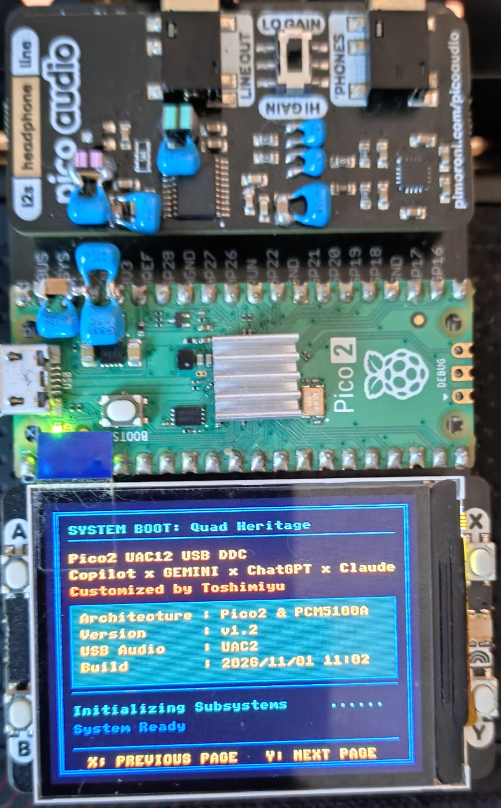
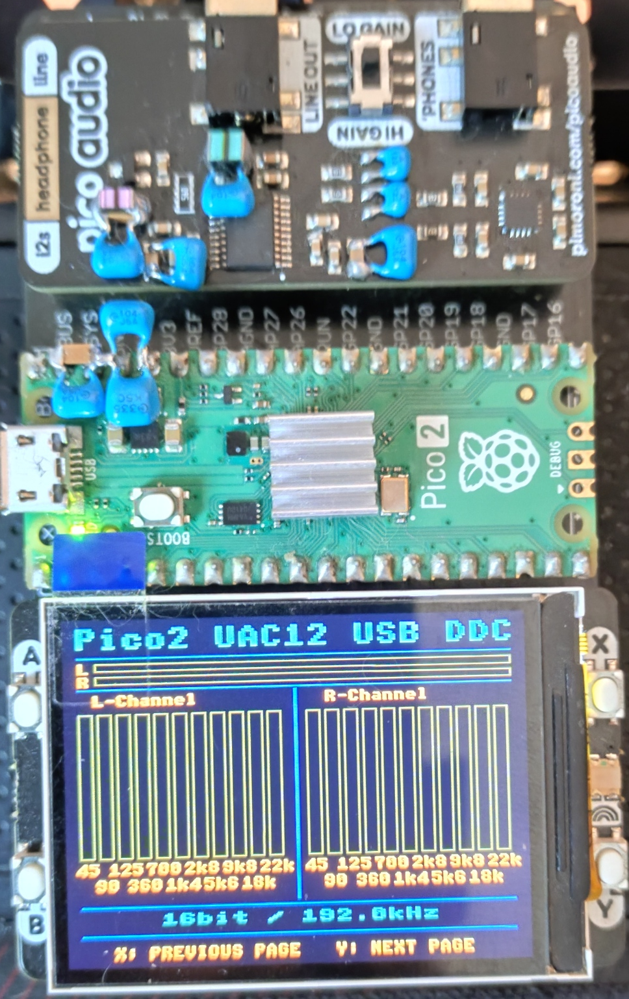
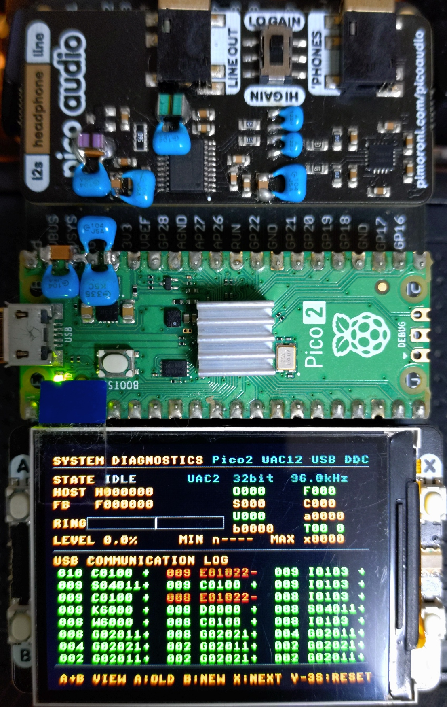

# Pico2 UAC12 USB DDC（TinyUSB UAC1/UAC2 切替対応）

[English](README_EN.md) | [日本語](README.md)

## 概要

本プロジェクトは、従来の `Pico2_UAC2_USBDDC_VerFinal_11FFT_NoOverSampling` を大幅に更新した、RP2350（Raspberry Pi Pico 2）用のUSB-DDCファームウェアです。

TinyUSBをベースにUSBオーディオ機能を再構成し、ビルド時にUSB Audio Class 1.0（UAC1）と2.0（UAC2）を選択できます。USBクラス層を分離しながら、共通のオーディオ処理コアを使用します。

### 主な変更点

- UAC1 / UAC2をビルド時に選択可能
- TinyUSBベースのUSBオーディオ層
- Audio State、Ring Buffer、Feedback制御の共通化
- バッファー監視機能を備えた診断画面
- 最大64件のUSBイベントログ
- UAC1/UAC2と同時に使用できるUSB CDC診断ログ（CSV）
- ストリーム再開およびサンプルレート切替処理の改善
- 未使用のGPIOデバッグ機能を削除
- 高クロック動作を修正
- UAC1 / UAC2で共通のオーディオ処理コアを使用

オーディオ処理では、引き続き以下を行いません。

- オーバーサンプリング（NOS）
- FIRフィルター処理
- サンプルレート変換

USB受信データはリングバッファーへ格納する前に、PCMサンプル幅（16/24/32-bit）とステレオフレーム境界を検証します。不正な形式や境界を検出した場合はTinyUSBのOUT FIFOを破棄して再同期し、CDC診断ログと統計カウンターに記録します。破棄後も通常の状態機械を維持し、`UNDERFLOW_FATAL`中は有効データの蓄積を待って既存の再バッファリング経路で復帰します。

また、PCM入力の隣接サンプルから急峻な変化の候補を計測します。しきい値超過時は`PCM_CLICK_CANDIDATE`として記録しますが、音声データや再生ゲインは変更しません。正常な高周波信号でも記録される可能性があるため、これはクリック確定ではなく調査用の診断です。

11バンドFFTアナライザー、リアルタイムレベルメーター、バッファー水位計などの表示機能を維持・改善しています。

**ビルド確認済み環境**

- Raspberry Pi Pico SDK v2.3.1
- Toolchain 15_2_Rel1

## 設計目標

- オーディオ信号経路を簡素化する
- 不要なソフトウェアDSP処理をなくす
- オーバーサンプリング、FIRフィルター、サンプルレート変換を行わない信号経路にする
- USB Audio Classごとのコードを分離し、保守性を高める
- UAC1 / UAC2で共通のオーディオエンジンを使う
- トラブルシューティング用のリアルタイム診断機能を提供する

PCM5100Aは内部でオーバーサンプリングとデジタルフィルター処理を行うため、本ファームウェアではソフトウェアのオーバーサンプリングとFIRフィルターを使用しません。

オーバーサンプリング、FIRフィルター、サンプルレート変換は行いませんが、出力には固定ゲイン比0.80を適用し、さらにUAC1/UAC2の音量設定（0～-64dB）およびミュートをソフトウェアで反映するため、PCMサンプルの値は変化します。

USBミュート／解除は入力PCMに約5msのリニアなゲインランプを適用します。音量変更は従来どおり即時反映します。リングやDMAに既に格納された音声は変更しないため、実際の出力への反映はバッファー分遅れます。入力異常やアンダーフロー時の自動ミュート／フェードは行いません。

## 変更履歴

### V1.8

#### USB受信・診断

- リングバッファーへの格納前にPCMサンプル幅とステレオフレーム境界を検証し、不正なデータの検出時はUSB受信FIFOを破棄して再同期
- PCM形式・フレーム境界の異常を診断イベントとカウンターに記録
- 入力PCMの急峻な変化をクリック候補として記録する診断を追加（再生音は変更せず、正常な音声でも候補となる場合あり）

#### 再生・ミュート処理

- 再生開始・再バッファリング時のプリフィルをサンプルレートに応じた約6ms分に統一し、蓄積前にDMAがリングを消費する問題を修正
- 再バッファリング中はリングの読み出しを停止し、既にDMAへ渡したデータを排出してから待機
- USBミュート／解除に約5msのゲインランプを追加（音量変更は従来どおり、異常時の自動ミュートは未実装）
- CDCログのメタデータに通常再生のプリフィル時間`PREFILL_MS`を追加

### V1.7

#### 診断ログ

- UAC1/UAC2のAudio Streaming Interface Alt=0要求を`A`として記録し、ストリーム終了イベント`C`と区別
- Alt設定要求、ストリームのopen/close、サンプルレート適用、状態遷移のイベント記録を追加・整理

#### 再生・表示処理

- 250µs周期のRepeating Timerを廃止し、無信号監視をCore0メインループでの経過時間判定に変更（500ms）
- 無信号時のバッファー後処理をメインループへ移し、周期割り込みの負荷を削減
- FFTバーの描画を左右チャンネル別の更新パスに分割

### V1.6
- 通常ビルドでは仮想COMポート（CDC）と診断ログ出力を無効化
- USB OUTパケット間隔が3ms以上になった場合、イベントとして記録
- PIO TX FIFO stallとDMA AHB転送エラーを検出し、異常時の状態・リング・DMA水位を記録

### V1.5
- UNDERFLOW判定をリング単体ではなく、リングとDMAプール内の合計フレーム数で行うよう変更

### V1.4
- USB CDC診断ログの通常サンプル間隔を1秒から100msへ短縮
- 状態遷移をミリ秒時刻のイベントとして記録
- プリフィル値・ファームウェア版をログメタデータへ出力
- セッション単位とストリーム単位の最大フィードバック差を記録
- 異常発生時の状態・リング・DMA水位を記録

### V1.3
- I²S DMA送信バッファーを専用リンカーセクションへ分離し、SRAM7の先頭（`0x20070000`）に配置
- 通常のRAM領域を448 KiBに制限し、上位64 KiBをDMAバッファー用として予約
- オーディオリングバッファーを1024から1536ステレオフレームへ拡張（192 kHz時、約8 ms分）

### V1.2
- srcフォルダー内、不要ファイルの整理削除

### V1.1
- 測定結果のデータ更新

### V1.0
`Pico2_UAC2_USBDDC_VerFinal_11FFT_NoOverSampling` からの主な変更点：
- `USB_AUDIO_CLASS_VERSION` によるUAC1 / UAC2のビルド時切替を追加
- USBオーディオ層をTinyUSBへ移行
- UAC1 / UAC2固有の実装を分離
- Audio State、Ring Buffer、Feedback制御を共通化
- バッファー監視付き診断画面を追加
- USBイベントログ表示（最大64件）を追加
- サンプルレート切替手順を改善
- ストリーム再開処理を改善
- 未使用のGPIOデバッグ機能を削除
- 高クロック動作を修正
- RAM上で実行する構成を維持

## 特長

- USB Audio Class 1.0 / 2.0 切替対応
- Async Feedback Endpointによる非同期フィードバック制御
- サンプルレートに応じた約6msのプリフィル後にI²S再生とPIフィードバック制御を開始
- リアルタイムバッファー水位計
- A特性補正付き11バンドFFT表示
- オーバーサンプリングなし（NOS）
- FIRフィルターなし
- オーバーサンプリング、FIRフィルター、サンプルレート変換を行わないI²S出力
- DMA + PIOによる低遅延I²S転送
- RP2350デュアルコア対応
- PICO_AUDIO_PACK対応
- Pico Display Pack 2.0対応

## 測定結果

Ver8の実測データ（測定記録・波形など）は、[DAC Modification History（2026年11月1日公開分）](https://github.com/Toshimiyu/DAC_Modification_History/tree/main/PicoAudioPack/20261101)で公開しています。

### ファームウェア比較

Ver7(開発呼称) → Ver8(開発呼称)

ハードウェア構成、測定環境、測定条件は同一で、ファームウェアのみを変更しています。

Ver7は `Pico2_UAC2_USBDDC_VerFinal_11FFT_NoOverSampling`、Ver8は `Pico2_UAC12_USBDDC` です。

### Ver7(開発呼称)

- TinyUSB UAC2ベース
- UAC2専用構成
- Audio State、Ring Buffer、Feedback制御をUAC2専用構成として実装
- オーバーサンプリング関連コードを削除
- FIR関連コードを削除
- ES系DAC対応コードを削除
- I2C出力コードを削除

### Ver8(開発呼称)

- UAC1 / UAC2をビルド時に選択可能
- TinyUSBベースのUSBオーディオ層
- Audio State、Ring Buffer、Feedback制御を共通化
- バッファー監視機能付き診断画面を追加
- USBイベントログ（最大64件）を追加
- ストリーム再開処理を改善
- サンプルレート切替処理を改善
- 未使用GPIOデバッグ機能を削除
- 高クロック動作を修正
- UAC1 / UAC2共通オーディオコアを採用

### FFT測定

#### 100Hz

| 項目 | Ver7 | Ver8 |
|------|------:|------:|
| THD | 0.00030% | 0.00033% |
| THD+N | 0.00563% | 0.00564% |

#### 1kHz

| 項目 | Ver7 | Ver8 |
|------|------:|------:|
| THD | 0.00141% | 0.00104% |
| THD+N | 0.00508% | 0.00484% |

#### 10kHz

| 項目 | Ver7 | Ver8 |
|------|------:|------:|
| THD | 0.00988% | 0.00991% |
| THD+N | 0.01854% | 0.01868% |

#### 20kHz

| 項目 | Ver7 | Ver8 |
|------|------:|------:|
| THD | 0.01585% | 0.01611% |
| THD+N | 0.02701% | 0.02712% |

#### IMD（19kHz + 20kHz）

| 項目 | Ver7 | Ver8 |
|------|------:|------:|
| THD | 0.01040% | 0.01046% |
| THD+N | 0.04454% | 0.04489% |

IMD差周波数成分（1kHz）：

- Ver7(開発呼称)：-121.09dB
- Ver8(開発呼称)：-121.96dB

### 測定結果まとめ

- 100Hz、10kHz、20kHzのTHDおよびTHD+NはVer7とVer8でほぼ同等でした。
- 1kHzではTHDが0.00141%から0.00104%へ低下し、THD+Nもわずかに改善しました。
- IMD測定ではTHDおよびTHD+Nはほぼ同等でしたが、差周波数成分（1kHz）は約0.9dB改善しました。
- 無音時スペクトルはVer7と同等レベルで、1kHz付近の不要成分はVer7が-114.70dB、Ver8が-114.89dBでした。

### 聴感テスト

Ver7(開発呼称)との比較：

- 明確な音質差は確認されていません。
- 診断機能やイベントログ機能追加後も、違和感のある変化は確認されていません。
- 今後も継続評価を行います。

### 注記

- 測定記録はVer7、Ver8それぞれ300回平均です。
- 今回の測定は24bit/96kHz、SB-1240改によるループバック条件で実施しており、結果は再生環境や測定系によって異なります。
- Ver8では複数の変更を同時に実施しているため、特定の変更と測定結果の因果関係や各変更の寄与度は個別に評価していません。
- FFT測定ではVer7と同等レベルの結果が得られました。

※測定記録はVer7、Ver8それぞれ1系列で、独立した再測定のばらつきは記録されていません。

### YouTube再生中のフォーマット切替確認（2026年11月1日）

Windows 11 26H2とGoogle Chrome 156.0.8078.80（公式ビルド、64ビット）でYouTubeを再生しながら、UAC1版とUAC2版の各対応フォーマットへ切り替えて確認しました。UAC1版では16/24bit、UAC2版では16/24/32bitについて、44.1/48/88.2/96kHzの組み合わせを確認しています。バッファー水位が安定した状態と、安定していない状態の両方で確認し、各確認はおおむね30秒前後でした（個別の再生時間は記録していません）。

※確認中、O（リングバッファーのオーバーフロー破棄）、F（USB受信FIFOの再同期時の破棄）、U（再生出力停止）は、いずれも0でした。これらのカウンターはデバイスが受信したデータの処理状況を示すもので、ホストやUSBバス上で発生した欠落を検出するものではありません。この結果は記載した環境での実機観測であり、他の環境や再生条件での動作を保証するものではありません。

## ハードウェア写真

### システム全体

> **組み立て時の重要注意（向き・配置）**
>
> Treedixドーターボードに各モジュールを取り付ける際は、接続の向きと、DACボード（Pico Audio Pack）およびPico Display Pack 2.0の並び順を必ず下のシステム全体写真で確認してください。向きや並び順を逆にすると、オーディオジャックなどの部品が物理的に干渉し、正しく取り付けられない場合があります。配線・半田付けを始める前に、写真と照らし合わせて配置を確認してください。

#### 起動画面



#### 再生画面



#### 診断画面



Pico 2 + Pico Audio Pack（PCM5100A）+ Pico Display Pack 2.0

## 表示仕様（Pico Display Pack 2.0）

起動時に起動画面を表示し、初期化が完了すると再生画面に切り替わります。

Pico Display Pack 2.0のXボタンで、以下の画面を一方向に切り替えられます。

- 起動画面
- 再生画面
- 診断画面

ボタン操作：

- X：次の画面（起動画面 → 再生画面 → 診断画面 → 起動画面）

診断画面では以下の操作ができます。

- A：古いUSBログへ移動
- B：新しいUSBログへ移動
- A+B：USBログと直近の音声状態履歴を切り替え
- Yを3秒長押し：診断カウンターとUSBイベントログをリセット（押している間、画面下にカウントダウンを表示）

USBイベントログは起動時から記録され、診断画面では起動後の直近64件を確認できます。USBバスリセット/切断、デバイス・構成・文字列記述子要求、構成完了/解除、UAC制御要求など、イベント発生時に記録します。一定間隔で再生状態を記録するログではないため、再生中に新しいイベントがなければログ表示は変わりません。曲の切り替えなどでUSBオーディオの状態が変化すると、新しいログが追加されることがあります。Y長押しでリセットすると、それまでの診断値とUSBイベントログを消去し、その後に発生したイベントから記録を再開します。O/F/S/C/Uのイベントカウンターは画面にかかわらずイベント発生時に更新されます。一方、バッファー水位や処理間隔などの周期的な診断統計は診断画面またはCDC出力が有効な状態でのCDC接続中に収集されます。診断画面を離れても取得済みの診断値は保持され、再入場後はその値から計測を再開します。再生画面では再生、FFT、ビット深度・サンプルレート表示を継続します。

#### USB CDC診断ログ

診断ログ出力用の仮想COMポートは、CMakeの`USB_BRINGUP_LEVEL`で選択します。`3`ではCDCインターフェースと診断ログ出力を有効にし、`0`、`1`、`2`ではCDCクラス、インターフェース、エンドポイントを無効にします。そのため、`0`、`1`、`2`では仮想COMポートは認識されず、CDC通信も発生しません。レベル`3`でPCから本機の仮想COMポートを開くと、診断ログが出力されます。

起動レベルは`0`（USB無効）、`1`（TinyUSB初期化のみ・CDCなし）、`2`（通常動作・CDCなし）、`3`（通常動作・CDC診断ログあり）です。既定値は`2`です。診断ログが必要な場合だけ、`-DUSB_BRINGUP_LEVEL=3`を指定してください。既存のCMakeキャッシュに`3`が保存されている場合は、`-DUSB_BRINGUP_LEVEL=2`を指定するか、CMakeキャッシュを削除して再構成してください。

CDC出力を有効にしてPCで本機の仮想COMポートを開くと、CDC接続からの経過時間をミリ秒で記録したCSVログを出力します。最初のメタデータ行にはファームウェア版、プリフィル値、UACモードを記録します。通常行は100ms間隔で、`MS,FREQ,BIT_DEPTH,USB_MODE,HOST_RATE,FEEDBACK_RATE,HF_DIFF_NOW,RING_NOW,RING_MIN,RING_MAX,MAX_HF_DIFF_SESSION,MAX_HF_DIFF_STREAM,STATE`の順です。`USB_MODE`はビルド構成に応じた`UAC1`または`UAC2`です。`HOST_RATE`は受信フレーム数から求める250ms窓の推定値です。`HF_DIFF_NOW`は両レートが有効な場合の符号付き`HOST_RATE - FEEDBACK_RATE`で、どちらかが0（未計測または無効）の場合は空欄です。`MAX_HF_DIFF_SESSION`はCDCログセッション中の最大絶対差、`MAX_HF_DIFF_STREAM`は現在のSTREAMING期間中の最大絶対差です。`RING_MIN`/`RING_MAX`は各ログ間隔で観測したリング水位です。状態遷移は`STATE,MS,FROM,TO,RATE,RING,DMA_POOL,USB_MODE`、異常は`ANOMALY,MS,CODE,DETAIL,USB_MODE,STATE,RATE,RING,DMA_POOL`形式で記録し、遷移・異常時の状態と水位も残します。状態遷移イベントは状態を更新したCore0で記録するため、周期サンプルより高い時間分解能で遷移時刻を比較できます。日時はデバイスで生成しないため、必要な場合はPC側の測定ソフトで付加してください。CDC接続中は、診断画面を開いていなくても周期的な診断統計を収集します。

通常再生の開始・再バッファリング時は、サンプルレートに応じた約6ms分をリングに蓄積してから出力します。蓄積中は新たなリングデータをDMAへ渡しませんが、既にDMAへ渡したデータは排出します。CSVメタデータの`PREFILL_MS`はこの蓄積時間です。既存のCMake設定`USB_AUDIO_PREFILL_FRAMES`（CSVの`PREFILL_FRAMES`）は、バッファリング以外の状態で残データの出力を開始するための従来のしきい値であり、通常再生のプリフィル量ではありません。

音声状態履歴は通常再生中も約100ms間隔で記録されます。異常を検知すると、その直前約4.8秒と直後約1.6秒の履歴を固定して診断画面で確認できます。異常イベントはUSBログへ赤色の`E`項目として追加されます。コードは`01`バッファーアンダーフロー、`02`オーバーフロー/破棄、`03`USB受信FIFO再同期、`04`USBバスリセット/切断、`05`再生出力停止、`06`Core0処理間隔超過、`07`Core1処理間隔超過、`08`USB OUT受信間隔3ms以上、`09`PIO TX FIFO stall、`0A`DMA AHB転送エラー、`0B`PCM形式、`0C`PCMフレーム境界、`0D`クリック候補です。クリック候補は正常な音声でも記録される可能性があります。これらのイベントはCDCログにも発生時点の状態・レート・リング水位・DMA水位を記録します。PIO stallは出力開始後10msを過ぎてから監視します。履歴表示の各項目は「秒・状態・リング水位・DMA水位」を表します。

### 再生画面

再生画面には、以下の情報がリアルタイム表示されます。

#### L/Rレベルメーター

左右の音声レベルをリアルタイムに表示します。

#### L/R独立11バンドFFT表示

A特性補正を適用した左右チャンネルの周波数スペクトルを個別に表示します。
FFTバーは左チャンネル、右チャンネルの順にチャンネルごとに分けて更新します。

#### オーディオ情報

現在のビット深度とサンプルレート（Fs）を表示します。

#### 表示に関する注意

※L/Rレベルメーターのピーク表示は入力信号レベルに合わせて連続的に更新されるため、ちらついて見えることがあります。これは正常な動作です。

音楽を再生していてもFFTバーやピークメーターが動かない場合は、まずスマートフォンやPCなどホスト側の音量設定を確認してください。本機のメーター表示はソフトウェアゲインに連動するため、ホスト側の音量が極端に小さい場合やミュートされている場合は、画面に反応が表示されないことがあります。

### 診断画面

Xボタンで起動画面 → 再生画面 → 診断画面 → 起動画面の順に切り替わります。Yボタンは画面移動には使わず、診断画面で3秒長押しすると診断カウンターとUSBイベントログをリセットします。

#### オーディオ状態表示

画面上部に、現在のUSBオーディオとバッファーの状態を表示します。

##### STATE

| 状態 | 説明 |
|------|------|
| IDLE | 停止中 |
| BUFF | バッファリング中 |
| STRM | ストリーミング中 |
| SWCH | サンプルレート切替中 |
| OVF! | バッファーオーバーフロー |
| UDF! | バッファーアンダーフロー |

##### HOST / FB

- HOST：ホストが要求したサンプルレート
- FB：ホストへ通知しているフィードバック周波数

##### ビット深度 / サンプルレート

次の形式で表示します。

```text
24bit 96.0kHz
```

##### RING / LEVEL

リングバッファーの現在の充填量と、全容量に対する割合を表示します。白いマーカーは目標バッファーレベルを示します。

バッファ水位は完全に一定値へ固定されるわけではありません。

Windowsや再生ソフト、USB転送タイミングなどに起因するホスト側送出レートの微小な変動に対し、PI制御がUSB Feedbackを連続的に補正します。

そのため、目標水位付近では水位がわずかに上下しながら維持されるのが正常動作です。

##### MIN / MAX

再生中に記録されたバッファーレベルの最小値と最大値を、サンプルフレーム単位で表示します。

#### 診断カウンター

診断画面の右側に処理統計を表示します。

| カウンター | 説明 |
|------------|------|
| O | リングバッファーオーバーフローにより破棄されたフレーム数 |
| F | USB受信FIFOの再同期中に破棄されたフレーム数 |
| S | サンプルレート切替中に破棄されたフレーム数 |
| C | 再起動または停止処理中にクリアされたフレーム数 |
| U | 再生中に検出された出力停止回数 |
| a | Core0の最大処理間隔（µs） |
| b | Core1の最大処理間隔（µs） |
| T | DMA末尾ブロックの出力回数 |

O/F/S/C/Uは画面にかかわらずイベント発生時に加算され、リセット後の累積値を示します。TはDMA末尾ブロックの出力条件を数えますが、診断画面が有効で、かつストリーミング中に限り加算されます。a/bやバッファー水位などの周期的な測定値も、診断画面を表示している間に収集された値です。

安定動作時には、通常、以下の値が期待されます。

```text
O = 0
F = 0
U = 0
```

#### USBイベントログ

画面下部にUSB通信イベントを表示します。

- 3列 × 8行
- 最大64件を保存
- 最新イベントは左上、最古イベントは右下

操作：

- Aボタン：古いイベント
- Bボタン：新しいイベント

表示時刻は起動後の経過秒数です。

このログはイベント発生時にだけ記録され、定期的な再生状態ログではありません。Yボタンを3秒長押しすると診断値とイベントログが消去され、以後のイベントから記録を再開します。

##### イベント記号

| 記号 | 意味 |
|------|------|
| M | USB Mount |
| A | HostからのAudio Streaming Interface Alt=0要求 |
| I | HostからのAudio Streaming Interface Alt>0要求 |
| O | `usb_audio_stream_open()` |
| C | `usb_audio_stream_close()`（構成記述子要求にも使用） |
| R | `usb_audio_apply_sample_rate()` |
| W | サンプルレート切替開始／`service_switch()`内の処理 |
| K | `service_switch()`完了 |
| G | USBコントロール要求 Get |
| S | USBコントロール要求 Set／オーディオ状態遷移 |
| U | USB切断 |
| D | デバイス記述子要求／バッファードレイン完了 |

イベント記号の一部は複数の用途で使われます。特に`C`、`S`、`D`は、後続の16進数フィールドとイベントの前後関係をあわせて判別してください。Alt切替時の`A → C → I → O`は、Alt=0要求、ストリーム終了、Alt>0要求、ストリーム開始の順を示す通常の動作であり、異常ではありません。

結果の接尾辞：

成功

```text
+
```

失敗

```text
-
```

#### 再生停止時に記録する情報

再生停止や音切れが発生した場合は、可能であればすぐに診断画面を撮影してください。USBイベントログには直近の64件が保存されます。

以下の情報を記録してください。

- STATE
- HOST
- FB
- RING / LEVEL
- MIN / MAX
- O / F / S / C / Uカウンター
- a / b / Tカウンター
- USBイベントログ全体
- 発生時のサンプルレートとビット深度
- PCのOS
- 再生ソフトウェア
- 発生時刻
- 発生直前に行った操作
- 自動的に再生が再開したか
- USBの再接続が必要だったか

これらの記録はUSB通信状態、バッファー動作、音声出力の状態を関連づけ、トラブルシューティングに役立ちます。故障分析の相談にAIサービスを利用する場合にも活用できます。

※シリアル番号などの個人情報は共有しないでください。

再生画面には診断情報は重ねて表示されません。

## 対応OS

- Windows 11（26H2で動作確認済み。Foobar2000でWASAPIモードで再生するときは、音源のサンプリングレートとWindows11のサンプリングレートを合わせてから再生を行ってください。ASIO4ALLやASIOドライバー等の場合は、サンプリングレートが異なっていても正常に再生されます。ASIO4ALL2.21で確認済み。）
- Android 16（Sony XQ-ES44スマートフォン。有償版Onkyo HF Player v2.15.2とFoobar2000 Android版 v2.26.1をOS標準オーディオドライバーで動作確認済み）

Onkyo HF Playerは仕様上UAC1モードのみ対応しています。本プロジェクトでは、UAC1モードで上記Android端末との動作を確認しています。

Onkyo HF Playerの独自ドライバーを使用せず、Android標準ドライバー（Foobar2000など）で使用する場合は、UAC1・UAC2の両モードで正常に動作することをSony XQ-ES44で確認しています。ただし、Onkyo HF Playerの独自ドライバーを使用した直後にAndroid標準ドライバーへ切り替える場合は、Androidに正しく認識させるため、USBコネクターを一度抜き差しして再接続してください。

※ Android 16（Sony XQ-ES44）接続時のUSBテスター実測値は、4.972 V・0.140 A（約0.696 W）です。

## USB Audio Classの選択

次のCMake設定で、ビルド時にUAC1 / UAC2を選択します。

```cmake
USB_AUDIO_CLASS_VERSION
```

| 値 | モード |
|----|--------|
| 1 | UAC1 |
| 2 | UAC2 |
| 未指定 | UAC2 |

ビルド環境がない方は、リリースノートからUAC1・UAC2それぞれのファームウェアをダウンロードして書き込み、ご使用ください。

### ビルドコマンド（2026-11-01確認）

リポジトリのルートディレクトリで実行してください。

※ビルド時は、事前に既存の`build`フォルダーを削除してCMakeキャッシュをクリアしてください。

#### UAC1ビルド

```powershell
cd <repository_directory>\Pico2_UAC12_USBDDC

cmake -S . -B build -DUSB_AUDIO_CLASS_VERSION=1

cmake --build build
```

#### UAC2ビルド

```powershell
cd <repository_directory>\Pico2_UAC12_USBDDC

cmake -S . -B build -DUSB_AUDIO_CLASS_VERSION=2

cmake --build build
```

#### 診断ログ出力ありでUAC2ビルド

```powershell
cd <repository_directory>\Pico2_UAC12_USBDDC

cmake -S . -B build -DUSB_AUDIO_CLASS_VERSION=2 -DUSB_BRINGUP_LEVEL=3

cmake --build build
```

診断ログ出力モードでビルドする場合だけ、CMake構成時に`-DUSB_BRINGUP_LEVEL=3`を追加してください。省略時は通常動作（レベル2）となり、仮想COMポートと診断ログ出力は無効です。

設定を変更した場合は、CMakeを再構成してから再ビルドしてください。

VS CodeのCMake Toolsを使用する場合は、CMakeキャッシュの `USB_AUDIO_CLASS_VERSION` を `1` または `2` に変更し、プロジェクトを再構成してください。キャッシュ値を変更しないと、以前の設定が使われます。

診断ログ出力モードにする場合は、CMake構成時に`-DUSB_BRINGUP_LEVEL=3`を指定してください。指定を省略した場合の既定値は`2`で、仮想COMポートと診断ログ出力は無効です。既存のCMakeキャッシュに`3`が残っている場合は、`-DUSB_BRINGUP_LEVEL=2`を指定して再構成してください。設定変更後は再ビルドが必要です。

### Windows PowerShellでのビルド

PowerShellで次のエラーが表示された場合：

```text
'cmake' is not recognized as an internal or external command
```

CMakeが利用可能か確認します。

```powershell
where.exe cmake
```

結果が表示されない場合は、CMakeをインストールしてください。

```powershell
winget install Kitware.CMake
```

インストール後、PowerShellを再起動します。CMakeがインストール済みでも見つからない場合は、インストール先をPATHに追加してください。

```powershell
$env:Path += ";C:\Program Files\CMake\bin"
```

恒久的に設定するには、Windowsのユーザー環境変数PATHにCMakeのインストール先を追加します。

インストールを確認します。

```powershell
cmake --version
```

バージョンが表示されたら、構成とビルドを実行します。

```powershell
cd C:\path\to\Pico2_UAC12_USBDDC

cmake -S . -B build -DUSB_AUDIO_CLASS_VERSION=1

cmake --build build
```

UAC2をビルドする場合は、`USB_AUDIO_CLASS_VERSION=1` を `USB_AUDIO_CLASS_VERSION=2` に変更してください。

SDK、コンパイラー、Ninjaに関するエラーが発生した場合は、Visual Studio CodeにRaspberry Pi Pico拡張機能をインストールし、次の環境を使用してください。

- Pico SDK v2.3.1
- Toolchain 15_2_Rel1

### 生成されるファームウェア

ビルドが成功すると、次のUF2ファイルが生成されます。

#### UAC1

```text
build/src/Pico2_UAC12_USBDDC_11FFT_NoOverSampling_UAC1.uf2
```

#### UAC2

```text
build/src/Pico2_UAC12_USBDDC_11FFT_NoOverSampling_UAC2.uf2
```

書き込み手順：

1. BOOTSELボタンを押したままにします。
2. Pico 2をPCに接続します。
3. RP2350ドライブが表示されます。
4. 生成されたUF2ファイルをドライブにコピーします。

### モード仕様

#### UAC1（`USB_AUDIO_CLASS_VERSION=1`）

- USB Audio Class 1.0
- PCM 16bit / 24bit
- 44.1kHz / 48kHz / 88.2kHz / 96kHz

#### UAC2（`USB_AUDIO_CLASS_VERSION=2`）

- USB Audio Class 2.0
- PCM 16bit / 24bit / 32bit
- サンプルレート上限はFull-Speed USBの帯域幅によって異なります

UAC固有のディスクリプターと制御ハンドラーは、選択したモードに応じて切り替わります。以下のモジュールは共通です。

- オーディオエンジン
- リングバッファー
- Async Feedback
- FFT処理
- 表示システム
- I²S出力

## 対応DAC

- Pico Audio Pack（PCM5100A）

Pico Audio Pack（PCM5100A）で動作を確認しています。

※PCM5102A搭載のDACボードも所有していますが、本プロジェクトのコンセプト外のため、現時点では動作確認を行っていません。お問い合わせがあれば確認します。

## USB入力仕様

- USB Audio Class 1.0 または 2.0
- Async Feedback Endpoint
- ステレオPCM

### UAC1

| ビット深度 | サンプルレート |
|------------|----------------|
| 16bit | 44.1 / 48 / 88.2 / 96kHz |
| 24bit | 44.1 / 48 / 88.2 / 96kHz |

### UAC2

| ビット深度 | サンプルレート |
|------------|----------------|
| 16bit | 44.1 / 48 / 88.2 / 96 / 176.4 / 192kHz |
| 24bit | 44.1 / 48 / 88.2 / 96kHz |
| 32bit | 44.1 / 48 / 88.2 / 96kHz |

### 注意事項

※RP2350 USB Device ControllerはFull-Speed USBのみをサポートします。

Full-Speed USBでの現在の上限：

| フォーマット | 最大レート |
|--------------|------------|
| UAC2 16bit | 192kHz |
| UAC2 24bit | 96kHz |
| UAC2 32bit | 96kHz |

※24bit / 32bitの176.4kHzおよび192kHzはFull-Speed USBのパケットサイズ上限を超えるため、サポートしていません。

※Onkyo HF PlayerはUAC1モードで動作確認しています。

## I²S出力仕様

- I²S
- ステレオ
- 32bit PCM形式
- 入力サンプルレート追従
- サンプルレート変換なし
- オーバーサンプリングなし
- オーバーサンプリング、FIRフィルター、サンプルレート変換を行わないI²S出力

### 注意事項

※ファームウェアは固定ゲイン比0.80に加え、ホストから受け取るUAC1/UAC2の音量設定（0～-64dB）とミュートをソフトウェアゲインに反映します。ホスト側の音量設定によって出力レベルが変わります。

## 再生に関する注意

- ※Windowsのオーディオ設定によって音切れが発生する場合があります
- ※安定性は再生ソフト、ホスト性能、システム負荷に左右されます
- ※サンプルレートの組み合わせによって、安定性が異なる場合があります

音切れが発生する場合は、次の方法を試してください。

- ASIOとWASAPIを切り替える
- 再生サンプルレートを下げる
- Windowsの出力サンプルレート設定を下げる

## FFTスペクトル表示とバッファーモニター

### リアルタイム11バンドFFTアナライザー

表示デバイス：Pico Display Pack 2.0

周波数帯：

- 45Hz
- 90Hz
- 125Hz
- 360Hz
- 700Hz
- 1.4kHz
- 2.8kHz
- 5.6kHz
- 9.8kHz
- 18kHz
- 22kHz

### FFT設定

- `FFT_LEN = 2048`
- 窓関数：ハン窓
- 重み付け：A特性
- Ring Buffer水位監視
- Feedback制御の可視化

RP2350の処理性能と低い表示遅延に合わせ、リアルタイムのFFTスペクトルとバッファー状態を表示します。

## アーキテクチャ

### ハードウェア

- Raspberry Pi Pico 2（RP2350）

### 開発環境

**ビルド確認済み**

- Raspberry Pi Pico SDK v2.3.1
- Toolchain 15_2_Rel1
- Visual Studio Code

### 表示・解析用ハードウェア

- Pico Display Pack 2.0
- ドーターボードを介して接続

### データ経路

- TinyUSB UAC1 / UAC2クラス層
- 共通オーディオ処理コア
- DMA + PIOによる低遅延I²S出力

### マルチコア処理

#### Core0

- LCD描画
  - FFT表示
  - バッファー水位表示
- メインループで無信号状態を監視し、500ms経過後にバッファーを後処理
- クロック切替制御
  - 44.1kHz系：336MHz
  - 48kHz系：360MHz
- ソフトウェア音声ミュート（出力ゲイン制御）

#### Core1

- I²S出力処理
- DMA転送処理
- FFT処理
  - ハン窓
  - A特性計算

### USB制御

- TinyUSB UAC1 / UAC2切替層
- 共通Async Feedbackクロック同期制御

### タイミング制御

- Core0メインループでの経過時間監視

### RAM上での実行

起動時にファームウェアをRAMへコピーし、RAM上で実行します。

Flashクロック分周設定：

```text
Divider = 3
```

動作中に確認された値：

| サンプルレート系統 | Flashクロック |
|--------------------|---------------|
| 44.1 / 88.2 / 176.4kHz | 112MHz |
| 48 / 96 / 192kHz | 120MHz |

## ピン配置

### I²Sインターフェース

| 機能 | GPIO |
|------|------|
| I²S DATA | GP9 |
| I²S BCLK | GP10 |
| I²S LRCK | GP11 |

### Pico Display Pack 2.0

| 機能 | GPIO |
|------|------|
| SPI / 制御インターフェース | GP16 - GP20 |

### 画面操作ボタン

| ボタン | GPIO | 用途 |
|--------|------|------|
| X | GP14 | 次の画面 |
| Y | GP15 | 診断画面で3秒長押しして診断をリセット |

内部プルアップを有効にしています。

### 診断ログ操作ボタン

| ボタン | GPIO | 用途 |
|--------|------|------|
| A | GP12 | 古いログへ移動 |
| B | GP13 | 新しいログへ移動 |

内部プルアップを有効にしています。

### RGB LED

GPIOリソースの競合を避けるため、Pico Display PackのRGB LED（GP6～GP8）は消灯状態にしています。現行ファームウェアではI²C出力およびGP5のDAC ENABLE信号は使用しません。

## ビルドと使用方法

※ビルド時は、事前に既存の`build`フォルダーを削除してキャッシュをクリアしてください。

1. ドーターボードを介して各ハードウェアを接続します。
2. Visual Studio CodeにRaspberry Pi Pico拡張機能をインストールします。
3. このリポジトリをクローンします。
4. Visual Studio Codeでプロジェクトをビルドします。
5. Pico 2のBOOTSELボタンを押したままPCに接続します。
6. RP2350のマスストレージデバイスが表示されます。
7. 生成されたUF2ファイルをデバイスにコピーします。
8. 再起動後、選択したUSB Audio Classデバイス（UAC1またはUAC2）として認識されます。

推奨環境：

- Pico SDK v2.3.1
- Toolchain 15_2_Rel1

## 開発の背景

オーディオ処理経路を簡素化し、不要なソフトウェア処理を減らすために、プロジェクトを再設計しました。

- ソフトウェアのオーバーサンプリングを削除
- ソフトウェアのFIRフィルターを削除
- 信号経路と処理経路を簡素化
- LUFAからTinyUSBへ移行
- UAC1 / UAC2共通アーキテクチャを採用
- 診断機能を強化
- FFT表示とクリッピング保護を維持

※PCM5100Aには、オーバーサンプリングとデジタルフィルター処理が内蔵されています。そのため、本プロジェクトではソフトウェアのオーバーサンプリング、FIRフィルター、サンプルレート変換を行いません。ただし、音量・ミュートのためのソフトウェアゲイン制御を行います。

処理性能向上のため、RP2350はオーバークロック設定で動作します。評価時の確認用システムにはヒートシンクを取り付けています。

### テスト環境

#### ハードウェア

- Raspberry Pi Pico 2（RP2350）
- Pico Audio Pack（PCM5100A）
- Pico Display Pack 2.0
- Sony XQ-ES44スマートフォン

#### ソフトウェア

**Windows**

- Windows 11 26H2
- Foobar2000 v2.26.1 (x64)
- ASIO4ALL 2.22

**Android**

- Android 16
- Onkyo HF Player v2.15.2
- Foobar2000 Android版 v2.26.1（ARM、OS標準オーディオドライバー）

## ライセンス

MIT License

Copyright (c) 2026 Toshimiyu

## 参考資料

- USB Audio Class 1.0 Specification
- USB Audio Class 2.0 Specification
- TinyUSB Project
- Raspberry Pi Pico SDK v2.3.1
- RP2350 Documentation
- PCM5100A Datasheet
- 参考にさせていただいたArqAlice様（Pico2UltraHiResUSBDDC）に感謝申し上げます
