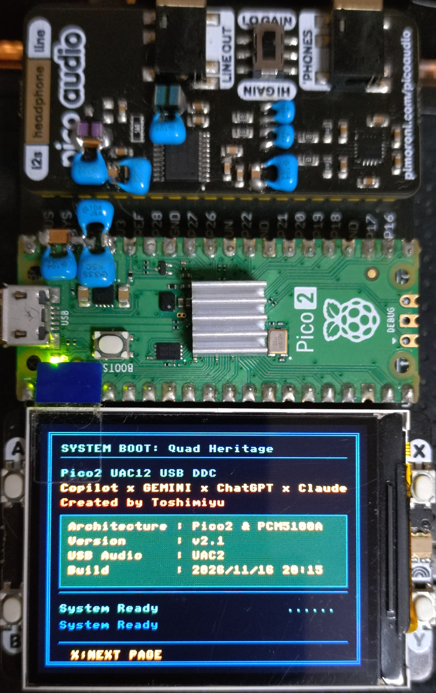
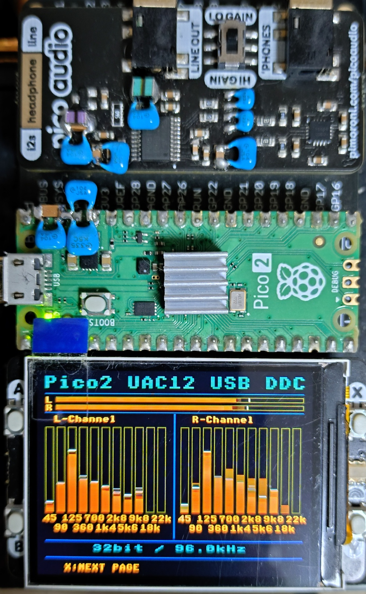
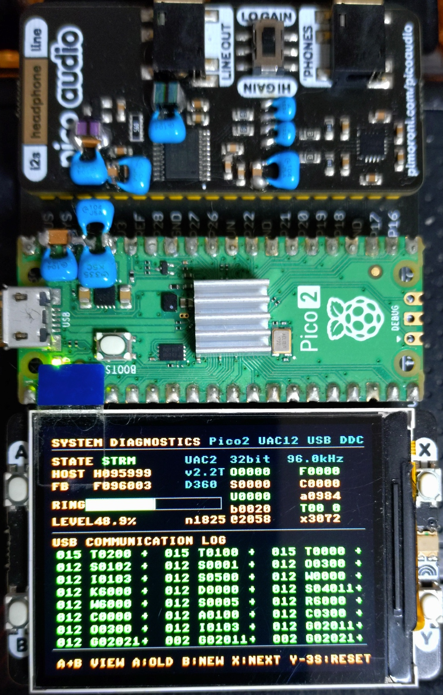

# Pico2 UAC12 USB DDC (TinyUSB UAC1/UAC2 Selectable)

[English](README_EN.md) | [日本語](README.md)

## Description

This project is a major update of `Pico2_UAC2_USBDDC_VerFinal_11FFT_NoOverSampling` for the RP2350 (Raspberry Pi Pico 2).

The USB audio subsystem has been redesigned around TinyUSB, allowing USB Audio Class 1.0 and 2.0 selection at build time while sharing a common audio-processing core.

### What's New

- UAC1 / UAC2 selectable build configuration
- TinyUSB-based USB audio layer
- Common Audio State / RingBuffer / Feedback architecture
- Improved diagnostic screen with buffer monitoring
- USB event logging (up to 64 events, or 256 with CDC enabled)
- USB CDC diagnostic CSV logging alongside UAC1/UAC2
- Enhanced stream restart and sample-rate switching handling
- Removal of unused GPIO debug functions
- High-power clock mode fixed operation
- Shared audio-processing core across UAC1 and UAC2

Audio processing remains:

- No Oversampling (NOS)
- No FIR Filtering
- No Sample Rate Conversion

Before USB audio data is written to the ring buffer, its PCM sample width (16/24/32-bit) and stereo frame boundaries are checked. If an invalid format or boundary is detected, the TinyUSB OUT FIFO is cleared to resynchronize and the event is recorded in diagnostic counters and, when enabled, the CDC log. The existing state machine continues to operate; in the internal `UNDERFLOW_FATAL` state (shown as `UDF!` in the Diagnostics screen's STATE display), it waits for valid data to accumulate and resumes through the normal rebuffering sequence.

The firmware also measures abrupt changes between adjacent input PCM samples and records threshold crossings as `PCM_CLICK_CANDIDATE`. This diagnostic does not change the audio data or playback gain. Normal high-frequency signals may also be reported, so a candidate does not confirm an audible click.

Display features such as the 11-band FFT analyzer, real-time level meters, and buffer water-level monitor have been retained and improved.

## Supported Environments

- Windows 11 (tested on 26H2 with UAC2; with WASAPI, match the source and Windows sample rates)
- Android 16 (Sony XQ-ES44, UAC1 using the Onkyo HF Player v2.15.2 USB driver)
- Build environment: Raspberry Pi Pico SDK v2.3.1 and Toolchain 15_2_Rel1

Android requires HF Player's USB driver rather than the standard audio driver. See [Supported Operating Systems](#supported-operating-systems) for details.

---

## Design Goals

This project was developed with the following goals:

- Simplify the audio signal path
- Remove unnecessary software DSP processing
- Avoid oversampling, FIR filtering, and sample-rate conversion in the signal path
- Improve maintainability by separating USB Audio Class specific code
- Share a common audio engine across UAC1 and UAC2
- Provide real-time diagnostics for troubleshooting

Software oversampling and FIR filtering were removed because the PCM5100A already implements internal oversampling and digital filtering.

The firmware does not perform oversampling, FIR filtering, or sample-rate conversion, but it always applies a fixed output gain ratio of 0.80 and also applies UAC1/UAC2 host volume settings (0 to -64 dB) and mute in software, changing the PCM sample values.

USB mute and unmute apply an approximately 5 ms linear gain ramp to incoming PCM. Volume changes still take effect immediately. Audio already queued in the ring and DMA is not changed, so the audible response is delayed by the queued audio. Input faults and underruns do not trigger automatic mute or fading.

---

## Change History

<details>
<summary>Show version history</summary>

### V2.1

- **Specification change:** Change the UAC1/UAC2 Output Terminal from `0x0304` (Desktop Speaker) to `0x0602` (Digital Audio Interface). On Android, use the UAC1 build and Onkyo HF Player with its USB driver; the UAC2 build is intended for Windows.
- Update UAC1/UAC2 `bcdDevice` to `0x0303`/`0x0313`, respectively
- Display O/F/S/C/U with four digits and add the current ring level `c` to the Diagnostics screen
- Add feedback-control values and USB OUT receive age to CDC samples, plus a detailed UNDERFLOW event row
- Emit USB event history over CDC and show USB configuration and CDC connection status on the Diagnostics screen
- Expand USB event history from 64 to 256 entries when CDC is enabled and fix the first periodic row's elapsed time after CDC connection

### V2.0

- Expand the audio ring from 2048 to 4096 stereo frames and set the feedback target and minimum normal-playback prefill to 3072 frames (75%)
- Set the base feedback correction limit to 100 ppm and the maximum low-water limit to 1000 ppm; add 500 ppm of the nominal sample rate to the buffering request
- Increase the sample-rate switch drain timeout to 150 ms
- Skip voltage and PLL reconfiguration when the system clock is unchanged, while still updating the I²S divider
- Change the UAC1/UAC2 USB configuration descriptor's maximum current to 150 mA
- Switch DMA transfers to completion-IRQ scheduling and send 64 frames of silence when PCM is temporarily unavailable during playback
- Base USB feedback on the actual output rate calculated from the PIO clock divider rather than the nominal sample rate
- When the USB receive FIFO exceeds 75% capacity, discard only old frames to reduce its fill to about 50%
- Support UAC1 volume `SET_RES` requests
- In CDC-enabled builds, record state transitions and DMA silence substitution for the CDC log and Playback Start Log screen


For changes in V1.0-V1.9, see [CHANGELOG_EN.md](CHANGELOG_EN.md).

</details>

---

## Features

- Selectable USB Audio Class 1.0 / 2.0
- Asynchronous feedback control using an Async Feedback Endpoint
- Starts I²S playback and PI feedback control after a prefill of the greater of approximately 6 ms or 3072 frames
- Real-time buffer water-level monitor
- 11-band FFT display with A-weighting
- No oversampling (NOS)
- No FIR filtering
- I²S output without oversampling, FIR filtering, or sample-rate conversion
- Low-latency I²S transfer using DMA + PIO
- RP2350 dual-core support
- PICO_AUDIO_PACK support
- Pico Display Pack 2.0 support

---

## Measurement Results

<details>
<summary>Show measurement results</summary>

Ver8 measurement data (measurement records and waveforms) is published in [DAC Modification History (released November 1, 2026)](https://github.com/Toshimiyu/DAC_Modification_History/tree/main/PicoAudioPack/20261101).

### Firmware Comparison

Ver7 (development designation) → Ver8 (development designation)

The hardware configuration, measurement environment, and measurement conditions were identical; only the firmware was changed.

Ver7 is `Pico2_UAC2_USBDDC_VerFinal_11FFT_NoOverSampling`, and Ver8 is `Pico2_UAC12_USBDDC`.

### Ver7 (development designation)

- TinyUSB-based UAC2
- UAC2-only configuration
- Audio State, Ring Buffer, and Feedback control implemented as a UAC2-specific configuration
- Oversampling-related code removed
- FIR-related code removed
- ES-series DAC support code removed
- I2C output code removed

### Ver8 (development designation)

- Build-time selection between UAC1 and UAC2
- TinyUSB-based USB audio layer
- Audio State, Ring Buffer, and Feedback control unified
- Added a diagnostic screen with buffer monitoring
- Added a USB event log (up to 64 events)
- Improved stream resume handling
- Improved sample-rate switching
- Removed unused GPIO debugging functionality
- Fixed high-clock operation
- Adopted a common audio core for UAC1 and UAC2

### FFT Measurements

#### 100Hz

| Item | Ver7 | Ver8 |
|------|------:|------:|
| THD | 0.00030% | 0.00033% |
| THD+N | 0.00563% | 0.00564% |

#### 1kHz

| Item | Ver7 | Ver8 |
|------|------:|------:|
| THD | 0.00141% | 0.00104% |
| THD+N | 0.00508% | 0.00484% |

#### 10kHz

| Item | Ver7 | Ver8 |
|------|------:|------:|
| THD | 0.00988% | 0.00991% |
| THD+N | 0.01854% | 0.01868% |

#### 20kHz

| Item | Ver7 | Ver8 |
|------|------:|------:|
| THD | 0.01585% | 0.01611% |
| THD+N | 0.02701% | 0.02712% |

#### IMD (19kHz + 20kHz)

| Item | Ver7 | Ver8 |
|------|------:|------:|
| THD | 0.01040% | 0.01046% |
| THD+N | 0.04454% | 0.04489% |

IMD difference-frequency component (1kHz):

- Ver7 (development designation): -121.09dB
- Ver8 (development designation): -121.96dB

### Summary of Measurement Results

- THD and THD+N at 100Hz, 10kHz, and 20kHz were nearly the same for Ver7 and Ver8.
- At 1kHz, THD decreased from 0.00141% to 0.00104%, and THD+N also improved slightly.
- In the IMD measurement, THD and THD+N were nearly the same, while the 1kHz difference-frequency component improved by approximately 0.9dB.
- The no-signal spectrum was at a level comparable to Ver7; the unwanted component near 1kHz measured -114.70dB for Ver7 and -114.89dB for Ver8.

### Listening Test

Compared with Ver7 (development designation):

- No clear difference in sound quality was identified.
- No unusual changes were identified after adding diagnostic and event-log features.
- Evaluation will continue.

### Notes

- The measurement records are averages of 300 measurements each for Ver7 and Ver8.
- These measurements were performed at 24-bit/96kHz using a modified SB-1240 loopback setup; results may vary depending on the playback environment and measurement system.
- Since multiple changes were made simultaneously in Ver8, the causal relationship between any specific change and the measurement results, as well as each change's individual contribution, was not evaluated.
- The FFT measurements produced results at a level comparable to Ver7.

*The records contain one measurement series each for Ver7 and Ver8; variation across independent repeat measurements is not documented.*

### Format Switching During YouTube Playback (November 1, 2026)

With YouTube playing on Windows 11 26H2 and Google Chrome 156.0.8078.80 (official 64-bit build), the supported output formats were selected and checked on both UAC1 and UAC2 firmware builds. The checked combinations were 16/24-bit at 44.1/48/88.2/96kHz in UAC1, and 16/24/32-bit at those rates in UAC2. Checks covered both stable and unsettled buffer-water-level conditions and lasted approximately 30 seconds; exact per-check durations were not recorded.

Note: During these checks, O (ring-buffer overflow discards), F (old frames discarded when the USB receive FIFO is near capacity), and U (playback output stops) all remained at zero. These counters describe how the device handled received data and do not detect losses on the host or USB bus. This is an observation on the stated setup, not a guarantee for other environments or playback conditions.

</details>

---

## Hardware Photo

### Complete System

> **Important assembly note (orientation and placement)**
>
> When mounting the modules on the Treedix daughterboard, carefully check their orientation and the order of the DAC board (Pico Audio Pack) and Pico Display Pack 2.0 against the complete-system photos below. Reversing the orientation or order may cause physical interference with components such as the audio jack, preventing proper installation. Confirm the placement against the photos before wiring or soldering.

#### Boot Screen



#### Playback Screen



#### Diagnostic Screen



Pico2 + Pico Audio Pack (PCM5100A) + Pico Display Pack 2.0

---

## Display and Diagnostics

Use X to cycle through Boot, Playback, and Diagnostics; CDC-enabled builds also include Playback Start Log. On the Diagnostics screen, A/B navigate USB event history, A+B toggles audio-state history, and holding Y for 3 seconds resets diagnostic values and USB event history. For screen details, event symbols, and anomaly codes, see the [diagnostic event reference](docs/DIAGNOSTICS_EN.md).

## Supported Operating Systems

- Windows 11 (verified on Windows 11 26H2. When playing in WASAPI mode with Foobar2000, match the source sample rate to the Windows 11 sample rate before playback. With ASIO4ALL or other ASIO drivers, playback works normally even if the sample rates differ. Verified with ASIO4ALL 2.22.)
- Android 16 (verified on a Sony XQ-ES44 smartphone with the paid Onkyo HF Player v2.15.2 USB driver and UAC1)

### Specification Notes (V2.1)

- Both UAC1 and UAC2 use Output Terminal `0x0602` (Digital Audio Interface). The tested Android standard driver does not recognize this configuration, and other players using Android's standard audio output are outside the support scope.
- On Android, use the UAC1 build and Onkyo HF Player with its USB driver. HF Player's proprietary driver does not support UAC2, so the UAC2 build is intended for Windows.
- Why HF Player's proprietary driver works with this configuration is unconfirmed. Future app or driver updates may change its behavior.
- `bcdDevice` is `0x0303` for UAC1 and `0x0313` for UAC2. These values were updated to distinguish the descriptors from earlier versions, but Windows may retain old device information.

Note: With the Android 16 (Sony XQ-ES44) device connected, a USB tester measured 4.972 V and 0.140 A (approximately 0.696 W).

### If Windows Does Not Recognize the Device

Windows may retain old device information after an earlier firmware version has been connected, preventing correct recognition. If this happens, try removing the device registration and reconnecting it:

1. Disconnect the device's USB cable.
2. Open **Device Manager** in Windows.
3. Select **View → Show hidden devices**.
4. Find this device under **Sound, video and game controllers** or another relevant category, right-click it, and select **Uninstall device**.
5. If an option to delete the driver software is shown, leave it **unchecked** and uninstall the device.
6. Reconnect the device and wait for Windows to recognize it again.

Confirm the device name before removal to avoid uninstalling another audio device. This procedure attempts to recreate the device registration; it may not resolve every recognition problem.

### Android Click Investigation

Historical observations and remaining unknowns are documented in the [Android test notes](docs/ANDROID_TEST_EN.md).

## Supported DAC

- Pico Audio Pack (PCM5100A)

Verified using:

- PICO_AUDIO_PACK

Note: I also own a PCM5102A-based DAC board, but it has not been tested because it is outside the scope of this project. I can check it if requested.

---

## USB Input Specifications

- USB Audio Class 1.0 or 2.0
- Async Feedback Endpoint
- Stereo PCM

### UAC1

| Bit Depth | Sample Rate |
|------------|------------|
| 16bit | 44.1 / 48 / 88.2 / 96kHz |
| 24bit | 44.1 / 48 / 88.2 / 96kHz |

### UAC2

| Bit Depth | Sample Rate |
|------------|-------------|
| 16bit | 44.1 / 48 / 88.2 / 96 / 176.4 / 192kHz |
| 24bit | 44.1 / 48 / 88.2 / 96kHz |
| 32bit | 44.1 / 48 / 88.2 / 96kHz |

### Notes

Note: The RP2350 USB Device Controller supports:

```text
Full-Speed USB only
```

Current Full-Speed limitations:

| Format | Maximum Rate |
|----------|----------|
| UAC2 16bit | 192kHz |
| UAC2 24bit | 96kHz |
| UAC2 32bit | 96kHz |

Note: 24bit/32bit 176.4kHz and 192kHz exceed the Full-Speed USB packet-size limit and are therefore not supported.

Note: Onkyo HF Player has been verified in UAC1 mode.

---

## I²S Output Specifications

- I²S
- Stereo
- 32bit PCM Format
- Input Sample Rate Follow Mode
- No Sample Rate Conversion
- No Oversampling
- I²S output without software oversampling, FIR filtering, or sample-rate conversion

### Notes

Note: The firmware applies a fixed output gain ratio of 0.80, and also applies UAC1/UAC2 volume settings (0 to -64 dB) and mute received from the host through software gain. The host volume setting therefore affects the output level.

---

## Playback Notes

- Note: Audio dropouts may occur depending on Windows audio settings
- Note: Stability depends on playback software, host performance, and system load
- Note: Stability may vary depending on the sample-rate combination

If dropouts occur:

- Switch between ASIO and WASAPI
- Reduce playback sample rate
- Reduce Windows output sample rate settings

---

## FFT Spectrum Display & Buffer Monitor

### Real-Time 11-Band FFT Spectrum Analyzer

Display Device:

- Pico Display Pack 2.0

Frequency Bands:

- 45Hz
- 90Hz
- 125Hz
- 360Hz
- 700Hz
- 1.4kHz
- 2.8kHz
- 5.6kHz
- 9.8kHz
- 18kHz
- 22kHz

### FFT Configuration

- FFT_LEN = 2048
- Window Function: Hann Window
- Weighting: A-Weighting
- RingBuffer Water-Level Monitoring
- Feedback-Control Visualization

The display system provides a real-time FFT spectrum visualization and buffer-status indication optimized for RP2350 performance and low display latency.

---

## Architecture

### Hardware

- Raspberry Pi Pico 2 (RP2350)

### Development Environment

**Build Verified**

- Raspberry Pi Pico SDK v2.3.1
- Toolchain 15_2_Rel1
- Visual Studio Code

### Display and Analysis Hardware

- Pico Display Pack 2.0
- Connected through a daughterboard

### Data Path

- TinyUSB UAC1/UAC2 class layer
- Shared audio-processing core
- DMA + PIO low-latency I²S output

### Multi-Core Processing

#### Core0

- LCD rendering
  - FFT visualization
  - Buffer water-level display
- Monitors audio inactivity in the main loop and cleans up the buffer after 500 ms
- Clock switching control
  - 44.1kHz family: 336MHz
  - 48kHz family: 360MHz
  - Rate changes with the same system clock skip voltage and system clock reconfiguration while updating the I²S divider
- Software audio mute (output gain control)

#### Core1

- I²S output processing
- DMA transfer handling
- FFT processing
  - Hann Window
  - A-Weighting calculation

### USB Control

- TinyUSB UAC1/UAC2 selectable layer
- Shared Async Feedback clock synchronization control

### Timing Control

- Elapsed-time monitoring in the Core0 main loop

### RAM Execution

The firmware is copied to RAM and executed from RAM during startup.

Flash clock divider setting:

```text
Divider = 3
```

Observed values during operation:

| Sample Rate Family | Flash Clock |
|-------------------|------------|
| 44.1 / 88.2 / 176.4kHz | 112MHz |
| 48 / 96 / 192kHz | 120MHz |

---

## Pin Assignment

### I²S Interface

| Function | GPIO |
|----------|------|
| I²S DATA | GP9 |
| I²S BCLK | GP10 |
| I²S LRCK | GP11 |

### Pico Display Pack 2.0

| Function | GPIO |
|----------|------|
| SPI / Control Interface | GP16 - GP20 |

### Navigation Buttons

| Button | GPIO | Usage |
|----------|------|------|
| X | GP14 | Next Screen |
| Y | GP15 | Hold for 3 seconds on the diagnostic screen to reset diagnostics |

Internal pull-up enabled.

### Diagnostic Log Buttons

| Button | GPIO | Usage |
|----------|------|------|
| A | GP12 | Older Log Entries |
| B | GP13 | Newer Log Entries |

Internal pull-up enabled.

### RGB LED

The Pico Display Pack RGB LED is intentionally kept off; its active-low channels on GP6-GP8 are driven high. The current firmware does not use I²C output or a DAC ENABLE signal on GP5.

---

## Build and Usage

Note: When switching between UAC1 and UAC2, delete the existing `build` folder and reconfigure to avoid stale objects. The Device Descriptor uses `bcdDevice` `0x0303` for UAC1 and `0x0313` for UAC2.

1. Connect all hardware through the daughterboard.
2. Install the Raspberry Pi Pico Extension for Visual Studio Code.
3. Clone this repository.
4. Build the project in Visual Studio Code.
5. Hold the Pico 2 BOOTSEL button while connecting to the PC.
6. The RP2350 mass-storage device appears.
7. Copy the generated UF2 file to the device.
8. After reboot, the system is recognized as the selected USB Audio Class device (UAC1 or UAC2).

Recommended Environment:

- Pico SDK v2.3.1
- Toolchain 15_2_Rel1

### USB Audio Class Selection

<details>
<summary>Show USB Audio Class selection</summary>

UAC1 and UAC2 can be selected at build time using:

```cmake
USB_AUDIO_CLASS_VERSION
```

| Value | Mode |
|---------|---------|
| 1 | UAC1 |
| 2 | UAC2 |
| Not specified | UAC2 |

If you don't have a build environment, download the UAC1 or UAC2 firmware from the release notes, flash it, and use it.

#### Build Commands (Verified: 2026-11-01)

Build from the repository root directory.

Note: Before building, delete the existing `build` folder to clear the CMake cache.

##### UAC1 Build

```powershell
cd <repository_directory>\Pico2_UAC12_USBDDC

cmake -S . -B build -DUSB_AUDIO_CLASS_VERSION=1

cmake --build build
```

##### UAC2 Build

```powershell
cd <repository_directory>\Pico2_UAC12_USBDDC

cmake -S . -B build -DUSB_AUDIO_CLASS_VERSION=2

cmake --build build
```

##### UAC2 Build with Diagnostic Logging

```powershell
cd <repository_directory>\Pico2_UAC12_USBDDC

cmake -S . -B build -DUSB_AUDIO_CLASS_VERSION=2 -DUSB_BRINGUP_LEVEL=3

cmake --build build
```

To build in diagnostic logging mode, add `-DUSB_BRINGUP_LEVEL=3` when configuring CMake. If omitted, the default is normal operation (level 2), with the virtual COM port and diagnostic log output disabled.

After changing the setting, re-run CMake configuration and rebuild the project.

When using VS Code CMake Tools, change the CMake cache value:

```text
USB_AUDIO_CLASS_VERSION
```

to either:

```text
1
```

or

```text
2
```

and then reconfigure the project.

If the cache value is not changed, the previous configuration remains active.

To build in diagnostic logging mode, specify `-DUSB_BRINGUP_LEVEL=3` when configuring CMake. If omitted, the default is level `2`, with the virtual COM port and diagnostic log output disabled. If an existing CMake cache still contains `3`, pass `-DUSB_BRINGUP_LEVEL=2` when reconfiguring. Rebuild after changing the setting.

---

#### Building from Windows PowerShell

For CMake discovery and PATH troubleshooting, see the [Windows PowerShell build guide](docs/BUILD_TROUBLESHOOTING_EN.md).


#### Generated Firmware Files

Successful builds generate the following UF2 files:

##### UAC1

```text
build/src/Pico2_UAC12_USBDDC_11FFT_NoOverSampling_UAC1.uf2
```

##### UAC2

```text
build/src/Pico2_UAC12_USBDDC_11FFT_NoOverSampling_UAC2.uf2
```

To program the device:

1. Hold the BOOTSEL button.
2. Connect Pico 2 to the PC.
3. The RP2350 drive appears.
4. Copy the generated UF2 file onto the drive.

---

#### Mode Specifications

##### UAC1 (`USB_AUDIO_CLASS_VERSION=1`)

- USB Audio Class 1.0
- PCM 16bit / 24bit
- 44.1kHz
- 48kHz
- 88.2kHz
- 96kHz

##### UAC2 (`USB_AUDIO_CLASS_VERSION=2`)

- USB Audio Class 2.0
- PCM 16bit / 24bit / 32bit
- Sample-rate limits depend on Full-Speed USB bandwidth

UAC-specific descriptors and control handlers are switched according to selected mode.

The following modules are shared:

- Audio Engine
- Ring Buffer
- Async Feedback
- FFT Processing
- Display System
- I²S Output

</details>

---

## Development Background

The project was redesigned to simplify the audio-processing path and reduce unnecessary software processing.

Changes include:

- Removal of software oversampling
- Removal of software FIR filtering
- Simplification of signal and processing paths
- Migration from LUFA to TinyUSB
- Shared UAC1/UAC2 architecture
- Enhanced diagnostic capabilities
- Maintenance of FFT visualization and clipping protection

The PCM5100A already contains internal oversampling and digital-filter processing.

For this reason, the firmware avoids software oversampling, FIR filtering, and sample-rate conversion. However, software gain control is applied for volume and mute.

The RP2350 is operated in an overclocked configuration.

The verified test system was equipped with a heatsink during evaluation.

## Tested Environment

### Hardware

- Raspberry Pi Pico 2 (RP2350)
- Pico Audio Pack (PCM5100A)
- Pico Display Pack 2.0
- Sony XQ-ES44 smartphone

### Software

**Windows**

- Windows 11 26H2
- Foobar2000 v2.26.1 (x64)
- ASIO4ALL 2.22

**Android**

- Android 16
- Onkyo HF Player v2.15.2

---

## License

MIT License

Copyright (c) 2026 Toshimiyu

---

## References

- USB Audio Class 1.0 Specification
- USB Audio Class 2.0 Specification
- TinyUSB Project
- Raspberry Pi Pico SDK v2.3.1
- RP2350 Documentation
- PCM5100A Datasheet
- With gratitude to ArqAlice (Pico2UltraHiResUSBDDC), whose work served as a reference
