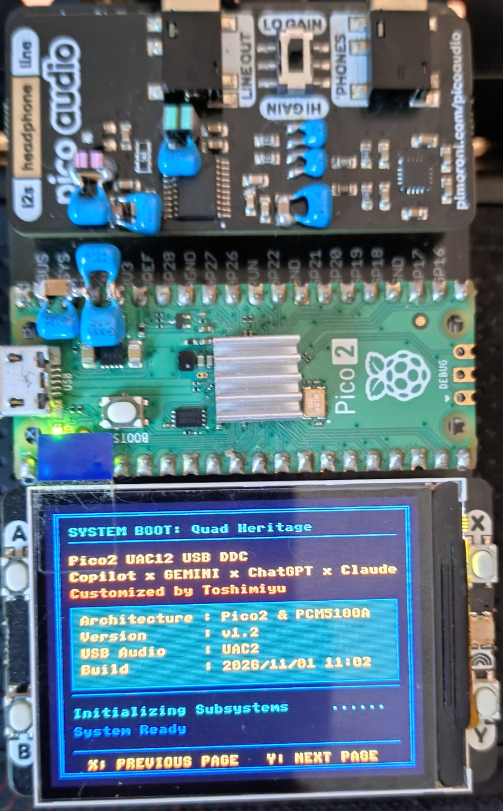
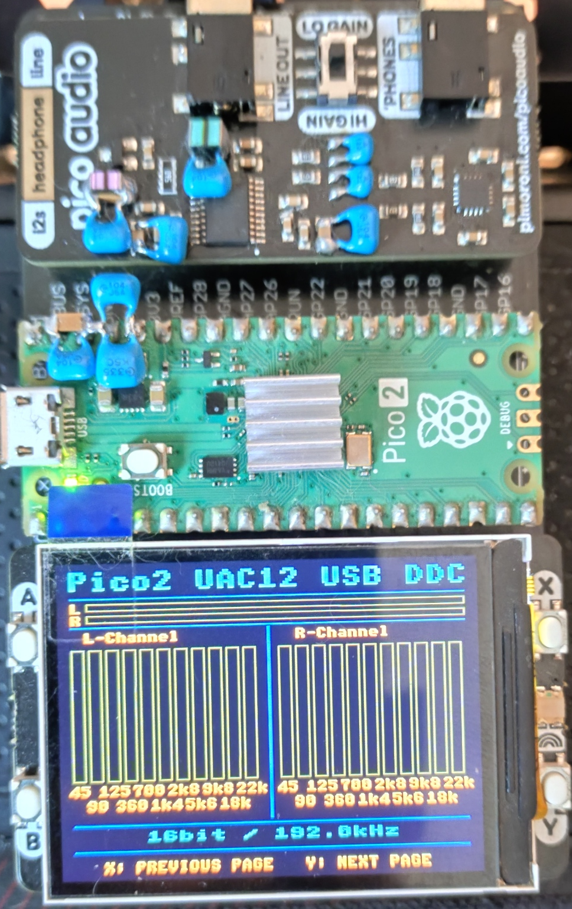
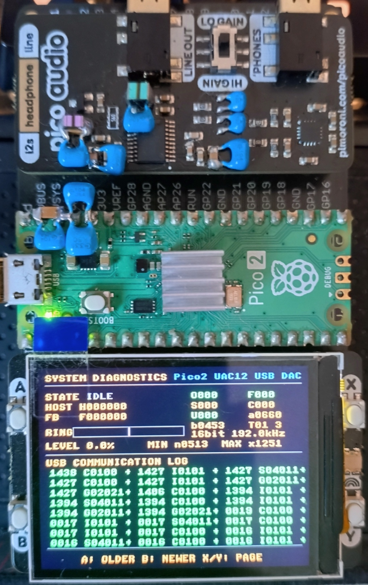

# Pico2 UAC12 USB DDC (TinyUSB UAC1/UAC2 Selectable)

[English](README_EN.md) | [日本語](README.md)

## Description

This project is a major update of `Pico2_UAC2_USBDDC_VerFinal_11FFT_NoOverSampling` for the RP2350 (Raspberry Pi Pico 2).

The USB audio subsystem has been redesigned around TinyUSB, allowing USB Audio Class 1.0 and 2.0 selection at build time while sharing a common audio-processing core.

### What's New

- UAC1 / UAC2 selectable build configuration
- TinyUSB-based USB audio layer
- Common Audio State / RingBuffer / Feedback architecture
- Improved diagnostic screen with buffer monitoring
- USB event logging (up to 64 events)
- USB CDC diagnostic CSV logging alongside UAC1/UAC2
- Enhanced stream restart and sample-rate switching handling
- Removal of unused GPIO debug functions
- High-power clock mode fixed operation
- Shared audio-processing core across UAC1 and UAC2

Audio processing remains:

- No Oversampling (NOS)
- No FIR Filtering
- No Sample Rate Conversion

Before USB audio data is written to the ring buffer, its PCM sample width (16/24/32-bit) and stereo frame boundaries are checked. If an invalid format or boundary is detected, the TinyUSB OUT FIFO is cleared to resynchronize and the event is recorded in diagnostic counters and, when enabled, the CDC log. The existing state machine continues to operate; in the internal `UNDERFLOW_FATAL` state (shown as `UDF!` in the Diagnostics screen's STATE display), it waits for valid data to accumulate and resumes through the normal rebuffering sequence.

The firmware also measures abrupt changes between adjacent input PCM samples and records threshold crossings as `PCM_CLICK_CANDIDATE`. This diagnostic does not change the audio data or playback gain. Normal high-frequency signals may also be reported, so a candidate does not confirm an audible click.

Display features such as the 11-band FFT analyzer, real-time level meters, and buffer water-level monitor have been retained and improved.

**Build Verified**

- Raspberry Pi Pico SDK v2.3.1
- Toolchain 15_2_Rel1

---

## Design Goals

This project was developed with the following goals:

- Simplify the audio signal path
- Remove unnecessary software DSP processing
- Avoid oversampling, FIR filtering, and sample-rate conversion in the signal path
- Improve maintainability by separating USB Audio Class specific code
- Share a common audio engine across UAC1 and UAC2
- Provide real-time diagnostics for troubleshooting

Software oversampling and FIR filtering were removed because the PCM5100A already implements internal oversampling and digital filtering.

The firmware does not perform oversampling, FIR filtering, or sample-rate conversion, but it always applies a fixed output gain ratio of 0.80 and also applies UAC1/UAC2 host volume settings (0 to -64 dB) and mute in software, changing the PCM sample values.

USB mute and unmute apply an approximately 5 ms linear gain ramp to incoming PCM. Volume changes still take effect immediately. Audio already queued in the ring and DMA is not changed, so the audible response is delayed by the queued audio. Input faults and underruns do not trigger automatic mute or fading.

---

## Change History

### V1.9

#### USB Reception and Diagnostics

- Add maximum USB OUT receive gap, ring-buffer headroom, and underrun count to the 100 ms CDC summary
- Add a 1 ms sampled ring-water average and report static RAM, ring, FFT, and LCD buffer memory figures in CDC metadata
- Record Core0/Core1 loop-interval distributions and stream start/stop and rate-change counts
- `USB_GAP_MAX_US` is the maximum interval between USB OUT receive callbacks while streaming, not a Windows-only delay measurement
- LCD draw-operation and per-channel FFT times are reported as 100 ms maximum/average values; loop distributions accumulate during streaming
- Expand the CDC transmit FIFO to 32 KiB to reduce log loss during temporary PC read stalls
- Add columns to periodic CDC rows; existing CSV analysis tools need to be updated for the new header

#### Display and Load

- Limit spectrum rendering to 30 FPS and make peak-marker fall speed time-based
- Complete bar decay after input changes stop and reduce blocking SPI drawing frequency without changing ring capacity

### V1.8

#### USB Reception and Diagnostics

- Validate PCM sample width and stereo frame boundaries before writing to the ring buffer; clear the USB receive FIFO to resynchronize when invalid data is detected
- Record PCM format and frame-boundary errors in diagnostic events and counters
- Add diagnostics for abrupt input PCM changes as click candidates without modifying playback audio; normal signals can also trigger a candidate

#### Playback and Mute

- Unify playback startup and rebuffering around approximately 6 ms of audio at the current sample rate, fixing premature DMA consumption before prefill completes
- Stop reading the ring during rebuffering and drain data already queued to DMA before waiting
- Add an approximately 5 ms gain ramp for USB mute and unmute; volume changes remain immediate and automatic mute on faults is not implemented
- Add `PREFILL_MS`, the normal playback prefill time, to CDC log metadata

### V1.7

#### Diagnostics

- Record the host's Audio Streaming Interface Alt=0 request as `A`, distinct from the stream-close event `C`, in both UAC1 and UAC2
- Add and clarify event records for alternate-setting requests, stream open/close, sample-rate application, and audio state transitions

#### Playback and Display

- Replace the 250 µs repeating timer with elapsed-time monitoring in the Core0 main loop for detecting audio inactivity (500 ms)
- Move silent-period buffer cleanup to the main loop, reducing periodic interrupt load
- Split FFT bar rendering into separate update passes for the left and right channels

### V1.6

- Record USB OUT packet intervals of 3 ms or longer as events
- Detect PIO TX FIFO stalls and DMA AHB transfer errors, recording state, ring, and DMA levels
- Disabled the virtual COM port (CDC) and diagnostic log output in the normal build; diagnostic logging mode is enabled only when `-DUSB_BRINGUP_LEVEL=3` is specified

### V1.5

- Changed underflow detection to consider total frames in the ring and DMA pool, rather than ring fill alone

### V1.4

- Reduced the USB CDC diagnostic sample interval from 1 second to 100 ms
- Logged state transitions as events with millisecond timestamps
- Added firmware version and prefill threshold to log metadata
- Recorded maximum feedback-rate differences per session and stream
- Added state, ring, and DMA-pool snapshots to anomaly events

### V1.3

- Moved the I²S DMA transmit buffers into a dedicated linker section at the start of SRAM7 (`0x20070000`)
- Limited the regular RAM region to 448 KiB and reserved the upper 64 KiB for DMA buffers
- Increased the audio ring buffer from 1024 to 1536 stereo frames (about 8 ms at 192 kHz)

### V1.2

- Removed unnecessary files from the `src` folder

### V1.1

- Updated measurement data

### V1.0

Major changes from `Pico2_UAC2_USBDDC_VerFinal_11FFT_NoOverSampling`:
- Added UAC1/UAC2 build-time selection using `USB_AUDIO_CLASS_VERSION`
- Migrated USB audio layer to TinyUSB
- Separated UAC1/UAC2 class-specific implementation
- Shared common Audio State, RingBuffer and Feedback architecture
- Added diagnostic screen with buffer monitor
- Added USB event log viewer (up to 64 events)
- Improved sample-rate switching sequence
- Enhanced stream restart handling
- Removed unused GPIO debug functionality
- Fixed operation in high-power clock mode
- Maintained RAM execution architecture

---

## Features

- Selectable USB Audio Class 1.0 / 2.0
- Asynchronous feedback control using an Async Feedback Endpoint
- Starts I²S playback and PI feedback control after a sample-rate-dependent prefill of approximately 6 ms
- Real-time buffer water-level monitor
- 11-band FFT display with A-weighting
- No oversampling (NOS)
- No FIR filtering
- I²S output without oversampling, FIR filtering, or sample-rate conversion
- Low-latency I²S transfer using DMA + PIO
- RP2350 dual-core support
- PICO_AUDIO_PACK support
- Pico Display Pack 2.0 support

---

## Measurement Results

Ver8 measurement data (measurement records and waveforms) is published in [DAC Modification History (released November 1, 2026)](https://github.com/Toshimiyu/DAC_Modification_History/tree/main/PicoAudioPack/20261101).

### Firmware Comparison

Ver7 (development designation) → Ver8 (development designation)

The hardware configuration, measurement environment, and measurement conditions were identical; only the firmware was changed.

Ver7 is `Pico2_UAC2_USBDDC_VerFinal_11FFT_NoOverSampling`, and Ver8 is `Pico2_UAC12_USBDDC`.

### Ver7 (development designation)

- TinyUSB-based UAC2
- UAC2-only configuration
- Audio State, Ring Buffer, and Feedback control implemented as a UAC2-specific configuration
- Oversampling-related code removed
- FIR-related code removed
- ES-series DAC support code removed
- I2C output code removed

### Ver8 (development designation)

- Build-time selection between UAC1 and UAC2
- TinyUSB-based USB audio layer
- Audio State, Ring Buffer, and Feedback control unified
- Added a diagnostic screen with buffer monitoring
- Added a USB event log (up to 64 events)
- Improved stream resume handling
- Improved sample-rate switching
- Removed unused GPIO debugging functionality
- Fixed high-clock operation
- Adopted a common audio core for UAC1 and UAC2

### FFT Measurements

#### 100Hz

| Item | Ver7 | Ver8 |
|------|------:|------:|
| THD | 0.00030% | 0.00033% |
| THD+N | 0.00563% | 0.00564% |

#### 1kHz

| Item | Ver7 | Ver8 |
|------|------:|------:|
| THD | 0.00141% | 0.00104% |
| THD+N | 0.00508% | 0.00484% |

#### 10kHz

| Item | Ver7 | Ver8 |
|------|------:|------:|
| THD | 0.00988% | 0.00991% |
| THD+N | 0.01854% | 0.01868% |

#### 20kHz

| Item | Ver7 | Ver8 |
|------|------:|------:|
| THD | 0.01585% | 0.01611% |
| THD+N | 0.02701% | 0.02712% |

#### IMD (19kHz + 20kHz)

| Item | Ver7 | Ver8 |
|------|------:|------:|
| THD | 0.01040% | 0.01046% |
| THD+N | 0.04454% | 0.04489% |

IMD difference-frequency component (1kHz):

- Ver7 (development designation): -121.09dB
- Ver8 (development designation): -121.96dB

### Summary of Measurement Results

- THD and THD+N at 100Hz, 10kHz, and 20kHz were nearly the same for Ver7 and Ver8.
- At 1kHz, THD decreased from 0.00141% to 0.00104%, and THD+N also improved slightly.
- In the IMD measurement, THD and THD+N were nearly the same, while the 1kHz difference-frequency component improved by approximately 0.9dB.
- The no-signal spectrum was at a level comparable to Ver7; the unwanted component near 1kHz measured -114.70dB for Ver7 and -114.89dB for Ver8.

### Listening Test

Compared with Ver7 (development designation):

- No clear difference in sound quality was identified.
- No unusual changes were identified after adding diagnostic and event-log features.
- Evaluation will continue.

### Notes

- The measurement records are averages of 300 measurements each for Ver7 and Ver8.
- These measurements were performed at 24-bit/96kHz using a modified SB-1240 loopback setup; results may vary depending on the playback environment and measurement system.
- Since multiple changes were made simultaneously in Ver8, the causal relationship between any specific change and the measurement results, as well as each change's individual contribution, was not evaluated.
- The FFT measurements produced results at a level comparable to Ver7.

*The records contain one measurement series each for Ver7 and Ver8; variation across independent repeat measurements is not documented.*

### Format Switching During YouTube Playback (November 1, 2026)

With YouTube playing on Windows 11 26H2 and Google Chrome 156.0.8078.80 (official 64-bit build), the supported output formats were selected and checked on both UAC1 and UAC2 firmware builds. The checked combinations were 16/24-bit at 44.1/48/88.2/96kHz in UAC1, and 16/24/32-bit at those rates in UAC2. Checks covered both stable and unsettled buffer-water-level conditions and lasted approximately 30 seconds; exact per-check durations were not recorded.

Note: During these checks, O (ring-buffer overflow discards), F (USB receive FIFO resynchronization discards), and U (playback output stops) all remained at zero. These counters describe how the device handled received data and do not detect losses on the host or USB bus. This is an observation on the stated setup, not a guarantee for other environments or playback conditions.

---

## Hardware Photo

### Complete System

> **Important assembly note (orientation and placement)**
>
> When mounting the modules on the Treedix daughterboard, carefully check their orientation and the order of the DAC board (Pico Audio Pack) and Pico Display Pack 2.0 against the complete-system photos below. Reversing the orientation or order may cause physical interference with components such as the audio jack, preventing proper installation. Confirm the placement against the photos before wiring or soldering.

#### Boot Screen



#### Playback Screen



#### Diagnostic Screen



Pico2 + Pico Audio Pack (PCM5100A) + Pico Display Pack 2.0

---

## Display Specification (Pico Display Pack 2.0)

At startup, the boot screen is displayed. After initialization completes, the playback screen is shown.

The X button on Pico Display Pack 2.0 cycles through the following screens in one direction:

- Boot Screen
- Playback Screen
- Diagnostic Screen

- X : Next screen (Boot → Playback → Diagnostics → Boot)

On the diagnostic screen:

- A : Scroll older USB log entries
- B : Scroll newer USB log entries
- A+B : Toggle between USB events and recent audio-state history
- Hold Y for 3 seconds : Reset diagnostic counters and the USB event log (a countdown is shown while holding)

USB event logging starts at boot, and the latest 64 events remain available on the Diagnostics screen. It records events such as USB bus resets/disconnects, device/configuration/string descriptor requests, configuration mount/unmount, and UAC control requests. This is event-driven logging, not a periodic playback-state log, so the display does not change while playback continues without a new event. Track changes and other USB audio state transitions may add new entries. Holding Y for 3 seconds clears the collected diagnostic values and USB event log; logging resumes with subsequent events. The O/F/S/C/U event counters are updated when events occur regardless of the active screen. Periodic diagnostic statistics, such as buffer levels and processing intervals, are collected while the Diagnostics screen is active or CDC is connected. Collected diagnostic values are retained when leaving the screen, and collection resumes from those values when it is reopened. The playback screen continues audio playback, FFT, and bit-depth/sample-rate display.

#### USB CDC Diagnostic Log

The diagnostic virtual COM port is controlled by the CMake option `USB_BRINGUP_LEVEL`. Level `3` enables the CDC class, interface, endpoints, and diagnostic log output; levels `0`, `1`, and `2` disable CDC, so no virtual COM port is enumerated and no CDC communication occurs. Open the device's virtual COM port on the PC to receive CSV logs with elapsed milliseconds since CDC connection. Metadata records the firmware version, prefill threshold, UAC mode, and a `#MEM` row with the `.data`-to-`.bss` static RAM span, ring allocation size, mutable FFT static data size, and LCD work-buffer size. `FFT_STATIC_BYTES` and `LCD_BUFFER_BYTES` are included in `SRAM_DATA_BSS_BYTES`, not additional amounts; LCD work buffers exclude flash-resident fonts. The ring is heap-allocated and reported separately. Free heap and stack usage are not measured.

A normal row is emitted every 100 ms with columns `MS,FREQ,BIT_DEPTH,USB_MODE,HOST_RATE,FEEDBACK_RATE,HF_DIFF_NOW,RING_NOW,RING_MIN,RING_AVG,RING_MAX,MAX_HF_DIFF_SESSION,MAX_HF_DIFF_STREAM,STATE,UNDERFLOW_COUNT,USB_GAP_MAX_US,USBBUF_CAPACITY,USBBUF_FREE_NOW,USBBUF_FREE_MIN_STREAM,USBBUF_FREE_MAX_STREAM,USBBUF_FREE_MIN_PCT_STREAM,LCD_MAX_US,LCD_AVG_US,LCD_COUNT,FFT_MAX_US,FFT_AVG_US,FFT_COUNT,RATE_CHANGE_COUNT,STREAM_START_COUNT,STREAM_STOP_COUNT,LOOP0_LT1MS,LOOP0_LT2MS,LOOP0_LT5MS,LOOP0_GE5MS,LOOP1_LT1MS,LOOP1_LT2MS,LOOP1_LT5MS,LOOP1_GE5MS`. `USB_MODE` is `UAC1` or `UAC2` according to the build configuration. `HOST_RATE` is estimated from received frames over a 250 ms window. `HF_DIFF_NOW` is the signed `HOST_RATE - FEEDBACK_RATE` when both rates are valid; it is blank if either rate is zero (not yet measured or unavailable). `MAX_HF_DIFF_SESSION` is the maximum absolute difference during the CDC session; `MAX_HF_DIFF_STREAM` is the maximum during the current STREAMING period. The latter excludes estimation windows overlapping the first second of STREAMING and remains zero until a valid measurement is available. `RING_MIN`/`RING_MAX` are the minimum/maximum ring levels observed during each log interval; `RING_AVG` is the mean of samples taken at approximately 1 ms intervals. State transitions use `STATE,MS,FROM,TO,RATE,RING,DMA_POOL,USB_MODE` rows; anomalies use `ANOMALY,MS,CODE,DETAIL,USB_MODE,STATE,RATE,RING,DMA_POOL`, including state, sample rate, ring fill, and frames in the DMA pool. Transition events are recorded on Core0 when the state changes, giving finer timing than periodic samples. The device does not generate calendar time; add it in the PC measurement software if needed. Periodic diagnostic statistics are collected even when the Diagnostics screen is not open while CDC is connected.

Despite their names, `USBBUF_CAPACITY` and `USBBUF_FREE_*` describe audio ring capacity and free space, not the TinyUSB receive FIFO.

The 32 KiB CDC transmit FIFO retains logs during temporary PC read stalls. If the FIFO runs out of space during a longer stall, periodic rows are dropped and reported as `LOG_ROWS_DROPPED` when transmission resumes. Ring, LCD, and FFT statistics in the next periodic row accumulate since the last successfully queued periodic row. Unsent FIFO data is discarded when CDC disconnects. This FIFO uses RAM only in CDC-enabled builds and is separate from the audio buffer.

USB startup levels are `0` (USB off), `1` (TinyUSB initialization only, no CDC), `2` (full operation, no CDC), and `3` (full operation with CDC diagnostic logging). The default is `2`. Specify `-DUSB_BRINGUP_LEVEL=3` only when diagnostic logging is needed. If an existing CMake cache still contains `3`, pass `-DUSB_BRINGUP_LEVEL=2` or clear the cache before reconfiguring.

Normal playback starts or resumes after approximately 6 ms of audio has accumulated in the ring at the current sample rate. While buffering, no new ring data is moved into DMA, but already queued DMA data is drained. The CSV metadata reports this time as `PREFILL_MS`. The existing CMake option `USB_AUDIO_PREFILL_FRAMES` (reported as `PREFILL_FRAMES`) is the legacy start threshold for draining queued data in non-buffering states, not the normal playback prefill amount.

Audio-state history is recorded about every 100 ms during playback. When an anomaly is detected, the approximately 4.8 seconds before and 1.6 seconds after it are retained as a frozen history for review. Detected anomalies are added to the USB log as red `E` entries: `01` buffer underflow, `02` overflow/discard, `03` USB receive FIFO resynchronization, `04` USB bus reset/disconnect, `05` playback output stop, `06` Core0 loop interval overrun, `07` Core1 loop interval overrun, `08` USB OUT packet interval of at least 3 ms, `09` PIO TX FIFO stall, `0A` DMA AHB transfer error, `0B` invalid PCM format, `0C` invalid PCM frame boundary, and `0D` click candidate. Click candidates can also be normal audio. These events also record state, rate, ring fill, and DMA-pool level in the CDC log. PIO stall monitoring starts 10 ms after output begins. Each history entry shows uptime seconds, audio state, ring-buffer level, and DMA-pool level.

### Playback Screen

The playback screen displays the following real-time information.

#### L/R Level Meter

Displays stereo audio levels in real time.

#### Independent L/R 11-Band FFT Display

Displays left and right channel frequency spectra independently with A-weighting applied.
FFT bars are updated one channel at a time, left channel first, followed by the right channel.

#### Audio Information

Displays current:

- Bit Depth
- Sample Rate (Fs)

#### Display Notes

Note: The peak indicator of the L/R level meter updates continuously according to input signal level and may appear to flicker. This is normal behavior.

If the FFT bars and peak meters do not move while music is playing, first check the volume setting on the host device, such as a smartphone or PC. The meter display follows the software gain, so an extremely low host volume or mute may result in no visible activity on the screen.

---

### Diagnostic Screen

Press the X button on the playback screen to switch to the diagnostic screen.

The X button cycles through Boot → Playback → Diagnostics → Boot. Y does not navigate between screens; holding it for 3 seconds on the Diagnostics screen resets the diagnostic counters and USB event log.

#### Audio Status Information

The upper section displays current USB audio and buffer status.

##### STATE

| State | Description |
|---------|---------|
| IDLE | Stopped |
| BUFF | Buffering |
| STRM | Streaming |
| SWCH | Sample-Rate Switching |
| OVF! | Buffer Overflow |
| UDF! | Buffer Underflow |

##### HOST / FB

- HOST: Host-requested sample rate
- FB: Feedback frequency reported to host

##### Bit Depth / Sample Rate

Displayed in the format:

```text
24bit 96.0kHz
```

##### RING / LEVEL

Displays:

- Current ring-buffer fill level
- Percentage of total capacity

The white marker indicates the target buffer level.

The buffer level does not converge to a perfectly fixed value.

The PI controller continuously adjusts USB Feedback to compensate for small fluctuations in the host-side transmission rate caused by Windows, media players, USB scheduling, and other factors.

As a result, the buffer level normally exhibits small movements around the target level rather than remaining perfectly stationary.

##### MIN / MAX

Minimum and maximum buffer levels recorded during playback.

Unit:

```text
Sample Frames
```

---

### Diagnostic Counters

The right side of the diagnostic screen displays processing statistics.

| Counter | Description |
|---------|---------|
| O | Frames discarded due to ring-buffer overflow |
| F | Frames discarded during USB receive FIFO resynchronization |
| S | Frames discarded during sample-rate switching |
| C | Frames cleared during restart or stop processing |
| U | Output stoppage count detected during playback |
| a | Maximum Core0 processing interval (µs) |
| b | Maximum Core1 processing interval (µs) |
| T | DMA tail-block output count |

O/F/S/C/U are incremented when their events occur, regardless of the active screen, and show counts accumulated since reset. T counts DMA tail-block output conditions, but is incremented only while diagnostics are enabled and audio is streaming. Periodic measurements such as a/b and buffer levels are also collected only while the Diagnostics screen is active.

For stable operation:

```text
O = 0
F = 0
U = 0
```

is generally expected.

---

### USB Event Log

The bottom area displays USB communication events.

Features:

- 3 columns × 8 rows
- Up to 64 events stored
- Newest event at upper-left
- Oldest event at lower-right

Navigation:

- A button → Older events
- B button → Newer events

Displayed timestamps indicate seconds after boot.

The USB log is event-driven, not periodic. Holding Y for 3 seconds clears the diagnostic values and event log; subsequent events are recorded normally.

#### Event Symbols

| Symbol | Meaning |
|---------|---------|
| M | USB Mount |
| A | Host request for Audio Streaming Interface Alt=0 |
| I | Host request for Audio Streaming Interface Alt>0 |
| O | `usb_audio_stream_open()` |
| C | `usb_audio_stream_close()` (also used for configuration descriptor requests) |
| R | `usb_audio_apply_sample_rate()` |
| W | Sample-rate switch begin / processing in `service_switch()` |
| K | `service_switch()` completed |
| G | USB Control Request Get |
| S | USB Control Request Set / audio state transition |
| U | USB Disconnect |
| D | Device descriptor request / buffer drain complete |

Some event symbols are reused for different purposes. In particular, use the following hexadecimal fields and surrounding event sequence to distinguish `C`, `S`, and `D` events. During an alternate-setting change, `A → C → I → O` represents the normal sequence of an Alt=0 request, stream close, Alt>0 request, and stream open; it does not indicate an error.

Result suffix:

Success

```text
+
```

Failure

```text
-
```

---

### Information to Capture When Playback Stops

If playback stops or audio dropouts occur, capture the diagnostic screen immediately if possible.

The USB event log stores up to the most recent 64 events.

Please record:

- STATE
- HOST
- FB
- RING / LEVEL
- MIN / MAX
- O/F/S/C/U counters
- a/b/T counters
- Entire USB event log
- Current sample rate
- Current bit depth
- PC operating system
- Playback software
- Timestamp of occurrence
- Actions immediately before failure
- Whether playback resumed automatically
- Whether USB reconnection was required

These records help correlate:

- USB communication status
- Buffer behavior
- Audio output activity

and assist troubleshooting.

The recorded information may also be used when consulting AI services regarding fault analysis.

Note: Do not share personal information such as serial numbers.

Diagnostic information is not overlaid on the playback screen.

---

## Supported Operating Systems

- Windows 11 (verified on Windows 11 26H2. When playing in WASAPI mode with Foobar2000, match the source sample rate to the Windows 11 sample rate before playback. With ASIO4ALL or other ASIO drivers, playback works normally even if the sample rates differ. Verified with ASIO4ALL 2.22.)
- Android 16 (verified on a Sony XQ-ES44 smartphone with the paid version of Onkyo HF Player v2.15.2 and Foobar2000 for Android using the OS standard audio driver)

Onkyo HF Player supports UAC1 mode only. This project has been verified with HF Player in UAC1 mode on the Android device listed above.

When not using Onkyo HF Player's proprietary driver and using the Android standard driver (e.g. with Foobar2000), normal operation has been verified in both UAC1 and UAC2 modes on the Sony XQ-ES44. However, after using Onkyo HF Player's proprietary driver, disconnect and reconnect the USB connector once before switching to the Android standard driver so that Android can recognize the device correctly.

Note: With the Android 16 (Sony XQ-ES44) device connected, a USB tester measured 4.972 V and 0.140 A (approximately 0.696 W).

### Android Click Investigation

Similar clicks occurred in this project, so the feedback limits were changed to `FB_BASE_LIMIT_PPM=50` and `FB_BOOST_MAX_PPM=500`. The results below are from the derived [Pico2_UAC12_USBDDC_Weather](https://github.com/Toshimiyu/Pico2_UAC12_USBDDC_Weather) project, not measurements of this project.

On November 13, 2026, playback was observed on a Sony XQ-ES44 running Android 16 with the standard audio driver, using UAC2 at 48 kHz / 32-bit. Windows 11 26H2 was also tested at 48 kHz / 32-bit.

- YouTube and the Music app on Android produced intermittent short clicks, including after the ring level settled around 50%. Changing the Android volume did not change the click volume.
- No clicks were observed while playing a silent WAV on Android. The USB format during silent playback was not confirmed.
- With the test settings `FB_BASE_LIMIT_PPM=50` and `FB_BOOST_MAX_PPM=500`, the Windows ring level reached 49.9% after about 3 minutes 40 seconds without observed dropouts. Android Foobar2000 reached 50% after about 2 minutes 27 seconds without observed clicks. Clicks remained with the Music app under the same settings.
- Turning DSEE Ultimate off in the Music app greatly reduced click frequency, but intermittent clicks and brief muddy-sounding audio remained.
- The diagnostic screen showed O/F/S/C/U at zero and no anomaly events. This does not rule out every kind of audio problem.

Reducing the feedback limits tended to improve the symptoms, but the cause remains unconfirmed. The roles of the app, audio effects, and feedback control need further investigation. Foobar2000 and disabling DSEE Ultimate are possible workarounds. Long-term stability with these settings has not been verified; overly narrow correction limits can allow the ring level to drift and cause dropouts.

---

## USB Audio Class Selection

UAC1 and UAC2 can be selected at build time using:

```cmake
USB_AUDIO_CLASS_VERSION
```

| Value | Mode |
|---------|---------|
| 1 | UAC1 |
| 2 | UAC2 |
| Not specified | UAC2 |

If you don't have a build environment, download the UAC1 or UAC2 firmware from the release notes, flash it, and use it.

### Build Commands (Verified: 2026-11-01)

Build from the repository root directory.

Note: Before building, delete the existing `build` folder to clear the CMake cache.

#### UAC1 Build

```powershell
cd <repository_directory>\Pico2_UAC12_USBDDC

cmake -S . -B build -DUSB_AUDIO_CLASS_VERSION=1

cmake --build build
```

#### UAC2 Build

```powershell
cd <repository_directory>\Pico2_UAC12_USBDDC

cmake -S . -B build -DUSB_AUDIO_CLASS_VERSION=2

cmake --build build
```

#### UAC2 Build with Diagnostic Logging

```powershell
cd <repository_directory>\Pico2_UAC12_USBDDC

cmake -S . -B build -DUSB_AUDIO_CLASS_VERSION=2 -DUSB_BRINGUP_LEVEL=3

cmake --build build
```

To build in diagnostic logging mode, add `-DUSB_BRINGUP_LEVEL=3` when configuring CMake. If omitted, the default is normal operation (level 2), with the virtual COM port and diagnostic log output disabled.

After changing the setting, re-run CMake configuration and rebuild the project.

When using VS Code CMake Tools, change the CMake cache value:

```text
USB_AUDIO_CLASS_VERSION
```

to either:

```text
1
```

or

```text
2
```

and then reconfigure the project.

If the cache value is not changed, the previous configuration remains active.

To build in diagnostic logging mode, specify `-DUSB_BRINGUP_LEVEL=3` when configuring CMake. If omitted, the default is level `2`, with the virtual COM port and diagnostic log output disabled. If an existing CMake cache still contains `3`, pass `-DUSB_BRINGUP_LEVEL=2` when reconfiguring. Rebuild after changing the setting.

---

### Building from Windows PowerShell

If PowerShell reports:

```text
'cmake' is not recognized as an internal or external command
```

verify whether CMake is available:

```powershell
where.exe cmake
```

If no result is returned, install CMake:

```powershell
winget install Kitware.CMake
```

Restart PowerShell after installation.

If CMake is already installed but not found, add the installation directory to PATH:

```powershell
$env:Path += ";C:\Program Files\CMake\bin"
```

To make the change permanent, add the CMake installation directory to the Windows user PATH environment variable.

Verify installation:

```powershell
cmake --version
```

If a version number is displayed, configure and build the project:

```powershell
cd C:\path\to\Pico2_UAC12_USBDDC

cmake -S . -B build -DUSB_AUDIO_CLASS_VERSION=1

cmake --build build
```

For UAC2 builds, change:

```text
USB_AUDIO_CLASS_VERSION=1
```

to

```text
USB_AUDIO_CLASS_VERSION=2
```

If SDK, compiler, or Ninja-related errors occur, install the Raspberry Pi Pico extension for Visual Studio Code and use:

- Pico SDK v2.3.1
- Toolchain 15_2_Rel1

---

### Generated Firmware Files

Successful builds generate the following UF2 files:

#### UAC1

```text
build/src/Pico2_UAC12_USBDDC_11FFT_NoOverSampling_UAC1.uf2
```

#### UAC2

```text
build/src/Pico2_UAC12_USBDDC_11FFT_NoOverSampling_UAC2.uf2
```

To program the device:

1. Hold the BOOTSEL button.
2. Connect Pico 2 to the PC.
3. The RP2350 drive appears.
4. Copy the generated UF2 file onto the drive.

---

### Mode Specifications

#### UAC1 (`USB_AUDIO_CLASS_VERSION=1`)

- USB Audio Class 1.0
- PCM 16bit / 24bit
- 44.1kHz
- 48kHz
- 88.2kHz
- 96kHz

#### UAC2 (`USB_AUDIO_CLASS_VERSION=2`)

- USB Audio Class 2.0
- PCM 16bit / 24bit / 32bit
- Sample-rate limits depend on Full-Speed USB bandwidth

UAC-specific descriptors and control handlers are switched according to selected mode.

The following modules are shared:

- Audio Engine
- Ring Buffer
- Async Feedback
- FFT Processing
- Display System
- I²S Output

---

## Supported DAC

- Pico Audio Pack (PCM5100A)

Verified using:

- PICO_AUDIO_PACK

Note: I also own a PCM5102A-based DAC board, but it has not been tested because it is outside the scope of this project. I can check it if requested.

---

## USB Input Specifications

- USB Audio Class 1.0 or 2.0
- Async Feedback Endpoint
- Stereo PCM

### UAC1

| Bit Depth | Sample Rate |
|------------|------------|
| 16bit | 44.1 / 48 / 88.2 / 96kHz |
| 24bit | 44.1 / 48 / 88.2 / 96kHz |

### UAC2

| Bit Depth | Sample Rate |
|------------|-------------|
| 16bit | 44.1 / 48 / 88.2 / 96 / 176.4 / 192kHz |
| 24bit | 44.1 / 48 / 88.2 / 96kHz |
| 32bit | 44.1 / 48 / 88.2 / 96kHz |

### Notes

Note: The RP2350 USB Device Controller supports:

```text
Full-Speed USB only
```

Current Full-Speed limitations:

| Format | Maximum Rate |
|----------|----------|
| UAC2 16bit | 192kHz |
| UAC2 24bit | 96kHz |
| UAC2 32bit | 96kHz |

Note: 24bit/32bit 176.4kHz and 192kHz exceed the Full-Speed USB packet-size limit and are therefore not supported.

Note: Onkyo HF Player has been verified in UAC1 mode.

---

## I²S Output Specifications

- I²S
- Stereo
- 32bit PCM Format
- Input Sample Rate Follow Mode
- No Sample Rate Conversion
- No Oversampling
- I²S output without software oversampling, FIR filtering, or sample-rate conversion

### Notes

Note: The firmware applies a fixed output gain ratio of 0.80, and also applies UAC1/UAC2 volume settings (0 to -64 dB) and mute received from the host through software gain. The host volume setting therefore affects the output level.

---

## Playback Notes

- Note: Audio dropouts may occur depending on Windows audio settings
- Note: Stability depends on playback software, host performance, and system load
- Note: Stability may vary depending on the sample-rate combination

If dropouts occur:

- Switch between ASIO and WASAPI
- Reduce playback sample rate
- Reduce Windows output sample rate settings

---

## FFT Spectrum Display & Buffer Monitor

### Real-Time 11-Band FFT Spectrum Analyzer

Display Device:

- Pico Display Pack 2.0

Frequency Bands:

- 45Hz
- 90Hz
- 125Hz
- 360Hz
- 700Hz
- 1.4kHz
- 2.8kHz
- 5.6kHz
- 9.8kHz
- 18kHz
- 22kHz

### FFT Configuration

- FFT_LEN = 2048
- Window Function: Hann Window
- Weighting: A-Weighting
- RingBuffer Water-Level Monitoring
- Feedback-Control Visualization

The display system provides a real-time FFT spectrum visualization and buffer-status indication optimized for RP2350 performance and low display latency.

---

## Architecture

### Hardware

- Raspberry Pi Pico 2 (RP2350)

### Development Environment

**Build Verified**

- Raspberry Pi Pico SDK v2.3.1
- Toolchain 15_2_Rel1
- Visual Studio Code

### Display and Analysis Hardware

- Pico Display Pack 2.0
- Connected through a daughterboard

### Data Path

- TinyUSB UAC1/UAC2 class layer
- Shared audio-processing core
- DMA + PIO low-latency I²S output

### Multi-Core Processing

#### Core0

- LCD rendering
  - FFT visualization
  - Buffer water-level display
- Monitors audio inactivity in the main loop and cleans up the buffer after 500 ms
- Clock switching control
  - 44.1kHz family: 336MHz
  - 48kHz family: 360MHz
- Software audio mute (output gain control)

#### Core1

- I²S output processing
- DMA transfer handling
- FFT processing
  - Hann Window
  - A-Weighting calculation

### USB Control

- TinyUSB UAC1/UAC2 selectable layer
- Shared Async Feedback clock synchronization control

### Timing Control

- Elapsed-time monitoring in the Core0 main loop

### RAM Execution

The firmware is copied to RAM and executed from RAM during startup.

Flash clock divider setting:

```text
Divider = 3
```

Observed values during operation:

| Sample Rate Family | Flash Clock |
|-------------------|------------|
| 44.1 / 88.2 / 176.4kHz | 112MHz |
| 48 / 96 / 192kHz | 120MHz |

---

## Pin Assignment

### I²S Interface

| Function | GPIO |
|----------|------|
| I²S DATA | GP9 |
| I²S BCLK | GP10 |
| I²S LRCK | GP11 |

### Pico Display Pack 2.0

| Function | GPIO |
|----------|------|
| SPI / Control Interface | GP16 - GP20 |

### Navigation Buttons

| Button | GPIO | Usage |
|----------|------|------|
| X | GP14 | Next Screen |
| Y | GP15 | Hold for 3 seconds on the diagnostic screen to reset diagnostics |

Internal pull-up enabled.

### Diagnostic Log Buttons

| Button | GPIO | Usage |
|----------|------|------|
| A | GP12 | Older Log Entries |
| B | GP13 | Newer Log Entries |

Internal pull-up enabled.

### RGB LED

The Pico Display Pack RGB LED is intentionally kept off; its active-low channels on GP6-GP8 are driven high. The current firmware does not use I²C output or a DAC ENABLE signal on GP5.

---

## Build and Usage

Note: Before building, delete the existing `build` folder to clear the cache.

1. Connect all hardware through the daughterboard.
2. Install the Raspberry Pi Pico Extension for Visual Studio Code.
3. Clone this repository.
4. Build the project in Visual Studio Code.
5. Hold the Pico 2 BOOTSEL button while connecting to the PC.
6. The RP2350 mass-storage device appears.
7. Copy the generated UF2 file to the device.
8. After reboot, the system is recognized as the selected USB Audio Class device (UAC1 or UAC2).

Recommended Environment:

- Pico SDK v2.3.1
- Toolchain 15_2_Rel1

---

## Development Background

The project was redesigned to simplify the audio-processing path and reduce unnecessary software processing.

Changes include:

- Removal of software oversampling
- Removal of software FIR filtering
- Simplification of signal and processing paths
- Migration from LUFA to TinyUSB
- Shared UAC1/UAC2 architecture
- Enhanced diagnostic capabilities
- Maintenance of FFT visualization and clipping protection

The PCM5100A already contains internal oversampling and digital-filter processing.

For this reason, the firmware avoids software oversampling, FIR filtering, and sample-rate conversion. However, software gain control is applied for volume and mute.

The RP2350 is operated in an overclocked configuration.

The verified test system was equipped with a heatsink during evaluation.

## Tested Environment

### Hardware

- Raspberry Pi Pico 2 (RP2350)
- Pico Audio Pack (PCM5100A)
- Pico Display Pack 2.0
- Sony XQ-ES44 smartphone

### Software

**Windows**

- Windows 11 26H2
- Foobar2000 v2.26.1 (x64)
- ASIO4ALL 2.22

**Android**

- Android 16
- Onkyo HF Player v2.15.2
- Foobar2000 for Android v2.26.1 (ARM, OS standard audio driver)

---

## License

MIT License

Copyright (c) 2026 Toshimiyu

---

## References

- USB Audio Class 1.0 Specification
- USB Audio Class 2.0 Specification
- TinyUSB Project
- Raspberry Pi Pico SDK v2.3.1
- RP2350 Documentation
- PCM5100A Datasheet
- With gratitude to ArqAlice (Pico2UltraHiResUSBDDC), whose work served as a reference
